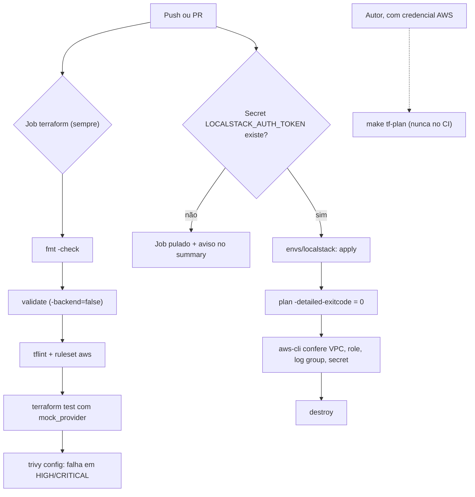
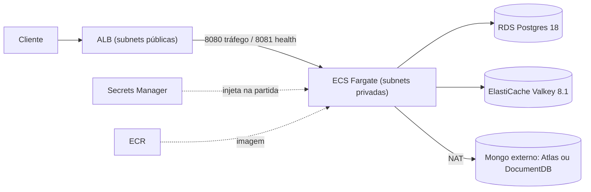

# Phase 5: Terraform AWS e vitrine - Research

**Researched:** 2026-11-05
**Domain:** Terraform/AWS (ECS Fargate, ALB, RDS, ElastiCache), validação em camadas a custo zero, CI gated por secret, documentação de vitrine
**Confidence:** HIGH para o que foi provado em protótipo; MEDIUM para o comportamento do LocalStack (sem token nesta sessão)

<user_constraints>
## User Constraints (from CONTEXT.md)

### Locked Decisions

#### Desenho da infra AWS
- **D-01:** Tasks Fargate, RDS e ElastiCache em **subnets privadas**; saída para a internet por **um NAT Gateway** (variável para 1 NAT por AZ). Subnets públicas só para o ALB e o NAT. O custo do NAT (~US$32/mês + tráfego) é documentado no README/docs.
- **D-02:** A task definition puxa a imagem do **ECR por padrão**; uma variável (ex.: `image_uri`/`image_repository`) permite apontar para `ghcr.io/lucasllo/link-pulse:sha-{sha7}`. A doc descreve o espelhamento GHCR → ECR (ex.: `crane copy` ou `docker pull/tag/push`) — sem push pelo CI.
- **D-03:** ALB com **listener HTTP 80 por padrão**; se `certificate_arn` (ou domínio) for informado, cria listener **443 com ACM** e redirect 80→443. Os testes mock cobrem os dois caminhos.
- **D-04:** Layout `infra/terraform/modules/{network,ecr,ecs,rds,cache,secrets}` (nomes finais a critério do planejador) + root **`envs/prod`** que compõe tudo. Backend **S3 com `use_lockfile`** declarado de forma parcial (`-backend-config`), **state local por padrão**; `.terraform.lock.hcl` commitado. — **Reversibility:** costly — mover módulos/roots depois exige reescrever testes, CI e `moved` blocks.
- **D-05:** URI do MongoDB entra como **variável sensível gravada num secret do Secrets Manager** e injetada na task via `secrets` (env `SPRING_MONGODB_URI`). Docs explicam Atlas (PrivateLink/peering) vs DocumentDB (compatibilidade parcial com aggregation/time-series).
- **D-06:** RDS com **`manage_master_user_password = true`** (senha gerada/rotacionada no Secrets Manager, nada no state); a task referencia o secret gerenciado (chave `password`). Postgres 18 (mesma major do local/kind).
- **D-07:** Serviço ECS com **desired 2, autoscaling min 2 / max 4, target tracking CPU ~60%**, deployment circuit breaker com rollback, sizing **0.5 vCPU / 1 GB** (espelhando o HPA do `values-prod`).
- **D-08:** Target group na **8080**, health check do ALB na **8081** `/actuator/health/readiness`. O SG das tasks aceita 8080 e 8081 **somente do SG do ALB**; o listener do ALB nunca expõe a 8081.

#### LocalStack e camadas de validação
- **D-09:** Root separado **`envs/localstack`** que reaproveita os mesmos módulos e compõe só o subset do Hobby: network (sem NAT), secrets, IAM (roles de execução/task) e CloudWatch log group. Os módulos precisam permitir isso (ex.: `enable_nat_gateway = false`).
- **D-10:** Provider do `envs/localstack` com **bloco `endpoints`** (ou `AWS_ENDPOINT_URL`), credenciais fake e `skip_*` — **sem tflocal/Python**.
- **D-11:** **`compose.localstack.yaml`** (imagem `localstack/localstack:2026.09.0`, `LOCALSTACK_AUTH_TOKEN` do ambiente) + alvos `make`: **`tf-check`** (fmt -check, validate, tflint, `terraform test`; sem Docker nem token), **`tf-localstack`** (sobe LocalStack, apply, verificação dos recursos, destroy), **`tf-plan`** (procedimento do plan real, documentado). Tabela "com make / sem make" do README segue o padrão atual.
- **D-12:** CI: job **`terraform`** sempre (fmt -check, validate com `-backend=false`, tflint + ruleset aws, `terraform test`, `trivy config`), **sem paths filter**; job **`localstack`** só quando o secret `LOCALSTACK_AUTH_TOKEN` existir — quando não existe, é pulado com aviso no job summary e **nunca falha**. Actions fixadas por SHA.
- **D-13:** `trivy config` **falha em HIGH/CRITICAL**; exceções aceitas ficam em `.trivyignore` (ou `#trivy:ignore`) **com um comentário justificando cada uma** (ex.: HTTP default sem certificado, chave AWS-managed em vez de CMK).
- **D-14:** `terraform test` **por módulo** (`modules/*/tests/*.tftest.hcl`, `mock_provider "aws"`, asserts de contrato: engine `valkey` 8.x, Postgres 18, CPU/mem, health 8081, SGs mínimos, HTTPS liga/desliga, NAT) **+ um teste de composição** do `envs/prod` checando a ligação entre módulos; inclui `expect_failures` para validações de variáveis.

#### README e documentação
- **D-15:** README vira **vitrine (~150-250 linhas)**; o conteúdo operacional atual (482 linhas) migra para `docs/` (sugestão: `api.md`, `operacao-local.md`, `kubernetes.md`, `observabilidade.md`, `terraform-aws.md`, `decisoes.md`). Nada do conteúdo atual se perde — só muda de lugar; links internos e âncoras citadas por outros arquivos (runbooks, scripts que imprimem URLs, `observability/README.md`) precisam ser atualizados.
- **D-16:** Diagramas em **Mermaid** no Markdown: um do fluxo do app (POST/GET → cache Valkey → Postgres; XADD → stream → consumer → Mongo → /stats; Prometheus/Grafana) e um da **topologia AWS** (VPC, subnets, ALB, ECS, RDS, ElastiCache, NAT, Secrets Manager, ECR, Atlas externo).
- **D-17:** Trade-offs: **tabela curta no README** (escolha → motivo, com link) + **`docs/decisoes.md`** estilo ADR leve (contexto, opções, escolha, consequência) cobrindo 302 vs 301, Valkey, coleção normal vs time-series, Terraform em camadas, Boot 4.1, Mongo na AWS via DocumentDB/Atlas, e as limitações aceitas (fail-open do rate limit, Valkey sem TLS no kind, Liquibase FSL).
- **D-18:** Topo do README: **badges** (status do `ci.yml`, pacote GHCR, Java 21, Spring Boot 4.1, licença MIT), bloco **"Em 2 minutos"** (clone → `make up` → `curl` e o que esperar) e **5-7 destaques técnicos**.
- **D-19:** Criar **`LICENSE` MIT** na raiz (Lucas Lopes, 2026).
- **D-20:** `estudos/` recebe **um link discreto** no README; a pasta não é alterada.

#### Evidências (prints e k6)
- **D-21:** Prints via **checkpoint humano**: o plano entrega o roteiro (make clean → up → seed → load, quais dashboards/painéis, janela de tempo, tema, nomes de arquivo fixos em `docs/img/`), o executor pausa e o autor captura e salva os PNGs.
- **D-22:** Prints saem da **stack compose** (mesma origem do `load-summary.json`), mais **um print do kind** (Grafana em `grafana.localtest.me` ou `kubectl get hpa,pods`) provando o caminho K8s.
- **D-23:** k6 no README como **tabela gerada a partir do `load/results/load-summary.json` versionado** (por cenário redirect/create: RPS, p95, p99, taxa de erro, threshold ok), com linha de contexto da máquina (laptop, Docker Desktop/WSL2) e aviso de que não é benchmark. O plano confere que os números citados batem com o JSON.

#### Herdado de decisões anteriores (não rediscutir)
- **D-24:** Versões do CLAUDE.md (Terraform 1.16.5 `>= 1.16, < 2.0`, provider `hashicorp/aws ~> 6.67`, tflint 0.64 + ruleset aws 0.49, LocalStack 2026.09.0, trivy, actions por SHA); o researcher confere se continuam atuais.
- **D-25:** ElastiCache com `engine = "valkey"` (8.x); Postgres 18; sem apply real; Mongo não provisionado; imagem `ghcr.io/lucasllo/link-pulse:sha-{sha7}` é o contrato publicado (PROJECT.md).
- **D-26:** Contrato de runtime: API 8080, management 8081, profile `prod`, `LINKPULSE_IP_HASH_KEY` obrigatória (>= 16 chars, vai para secret), `LINKPULSE_BASE_URL`, `LINKPULSE_SELF_HOSTS`, `SERVER_TOMCAT_REMOTEIP_INTERNAL_PROXIES` (CIDR da VPC, atrás do ALB), `LOGGING_STRUCTURED_FORMAT_CONSOLE=ecs`, `SPRING_DATASOURCE_*` com `sslmode=require`, `SPRING_DATA_REDIS_*` — ver `deploy/helm/link-pulse/values-prod.yaml`.
- **D-27:** Toda documentação em pt-BR; commits sem co-autoria do Claude.

### Claude's Discretion
- Nomes exatos dos módulos, variáveis e outputs; uso ou não de `terraform-aws-modules/vpc` (preferência: escrito à mão).
- Região default (sugestão `us-east-1` ou `sa-east-1`, documentada), CIDRs, classe da instância RDS (ex.: `db.t4g.micro`) e do ElastiCache (`cache.t4g.micro` ou serverless), retenção de logs.
- **TLS do Valkey no ElastiCache:** decidir `transit_encryption_enabled` e, se ligado, a env do app (`SPRING_DATA_REDIS_SSL_ENABLED=true`) — Phase 4 (WR-06) documentou a lacuna de TLS do Valkey; o researcher confirma que o app aceita sem mudança de código.
- Como o `tf-localstack` verifica os recursos (aws cli via container, `terraform output`, ou `check` blocks).
- Ordem/forma de migrar o README para `docs/` e onde fica o procedimento do plan real (provavelmente `docs/terraform-aws.md`).

### Deferred Ideas (OUT OF SCOPE)
None — discussion stayed within phase scope
</user_constraints>

## Summary

A fase é viável como foi decidida, e o caminho do Terraform já está provado. Nesta sessão eu montei em scratchpad um protótipo completo (7 módulos, `envs/prod`, `envs/localstack`, testes por módulo, teste de composição e o `check.sh` proposto) e rodei tudo no Windows/Git Bash com Terraform 1.16.7, provider AWS 6.72.0, tflint 0.65.0 + ruleset aws 0.50.0 e trivy 0.76.2. Resultado: `fmt`, `validate`, `tflint` e `terraform test` verdes em 3 min 18 s a frio, sem Docker, sem token e sem credencial AWS, e só **quatro** achados HIGH/CRITICAL no trivy, todos justificáveis e silenciados por `#trivy:ignore`.

Três descobertas mudam o plano. **(1) O app não aceita TLS no Valkey sem mudança de código:** `ClickStreamConsumer.dedicatedConnectionFactory` monta a conexão sem SSL, e o `auth_token` do ElastiCache só existe com TLS ligado. Com o código fora de escopo, o default correto é `transit_encryption_enabled = false`, sem senha, protegido por SG. ElastiCache Serverless fica descartado, porque sempre usa TLS. **(2) O health check do ALB na readiness (D-08) tem um efeito colateral no ECS:** o scheduler substitui tasks que falham no health check do load balancer, então uma queda do Postgres ou do Valkey vira churn de tasks, exatamente o que o WR-04 tentou evitar. A decisão fica, mas precisa de confirmação do autor (ver Open Questions). **(3) `mock_provider` tem armadilhas específicas** (listas vazias, JSON inválido, ARNs inválidos, `master_user_secret` vazio, recursos efêmeros não suportados); todas foram reproduzidas e têm receita pronta num único `aws.tfmock.hcl` compartilhado.

O LocalStack é a única camada não exercitada: não há token nesta máquina e o Docker estava parado. A fiação do provider foi provada (as cinco APIs batem em `localhost:4566`, nenhuma chamada à AWS), mas o `apply` real depende de um checkpoint humano com o token. A vitrine não tem risco técnico; o risco é mecânico (links relativos ao mover conteúdo para `docs/` e a semântica invertida do JSON do k6).

**Primary recommendation:** escrever os módulos seguindo os snippets verificados daqui, usar `command = apply` (o default) nos testes mock com um `tests/mocks/aws.tfmock.hcl` compartilhado, e entregar `tf-check` como script bash igual no laptop e no CI.

<phase_requirements>
## Phase Requirements

| ID | Description | Research Support |
|----|-------------|------------------|
| IAC-01 | Módulos Terraform para rede, ECR, ECS Fargate (+ ALB), RDS Postgres, ElastiCache Valkey e secrets | Layout em "Recommended Project Structure"; módulo extra `app-iam` necessário para o D-09. Grafo sem ciclo provado com `validate` e teste de composição. Prova: `make tf-check` |
| IAC-02 | `fmt`/`validate`/`tflint` passam e rodam no CI | `check.sh` verificado; job `terraform` em Code Examples. Prova: `bash infra/terraform/check.sh` |
| IAC-03 | `terraform test` com `mock_provider "aws"` cobre todos os módulos com asserts | Receitas de Pitfalls 1 a 7 e `aws.tfmock.hcl`. Prova: `terraform -chdir=infra/terraform/modules/<m> test` |
| IAC-04 | Apply parcial no LocalStack Hobby via `make`, rodando no CI quando o secret do token existir | Subset confirmado nas páginas de serviço; job gate em Code Examples. Prova real exige token (checkpoint humano) |
| IAC-05 | Procedimento de `plan`/apply na AWS real documentado (sem executar) | Roteiro em Pattern 6; pré-voos de versão em Pitfalls 12 e 13. Prova: `docs/terraform-aws.md` |
| DOC-01 | README com diagrama, `make up`/`make k8s`, k6 e prints | Mapa de migração em Pattern 7; números e semântica do JSON em Pitfall 18; prints por checkpoint |
| DOC-02 | README documenta os trade-offs | D-17; limitações novas desta pesquisa entram em `docs/decisoes.md` (ver Pattern 7) |
</phase_requirements>

## Project Constraints (from CLAUDE.md)

Diretivas de `.claude/CLAUDE.md` que valem aqui:

- Validação em camadas: `apply` no LocalStack Hobby só da parte suportada; `terraform test` com `mock_provider "aws"` para ECS, RDS, ElastiCache e ECR; `validate`, `tflint` e `trivy config`; `plan` documentado.
- `.terraform.lock.hcl` commitado; `required_version = ">= 1.16, < 2.0"`; provider `version = "~> 6.67"`.
- Recursos escritos à mão em módulos próprios mostram mais domínio; módulo da VPC só se o prazo apertar.
- ElastiCache com `engine = "valkey"`; chamar de "Redis (Valkey)" no README.
- Actions por SHA, nunca por tag mutável, por causa do incidente trivy-action de mar/2026.
- Windows: GNU make não vem no Git Bash; Docker Desktop com WSL2.
- Toda mudança de arquivo via fluxo GSD. Commits sem `Co-Authored-By` nem "Generated with Claude Code" (memória do usuário e D-27).

Divergências entre CLAUDE.md e o estado real, a respeitar:

| CLAUDE.md diz | Realidade | Efeito |
|---------------|-----------|--------|
| Baseline Boot 3.5.16 | `<version>4.1.2</version>` [VERIFIED: app/pom.xml:10] | README e badge dizem Boot 4.1; o texto atual já diz 4.1.2 |
| tflocal 0.26.0 | D-10 proíbe, e a doc do LocalStack diz que `tflocal` está deprecated em favor de `lstk terraform` [CITED: docs.localstack.cloud/aws/integrations/infrastructure-as-code/terraform/] | Sem tflocal |
| Terraform 1.16.5, tflint 0.64, ruleset 0.49 | Há patches mais novos; ver Standard Stack | D-24 pede essa conferência |

## Architectural Responsibility Map

| Capability | Primary Tier | Secondary Tier | Rationale |
|------------|-------------|----------------|-----------|
| Terminação HTTP/TLS e roteamento público | Edge (ALB, subnets públicas) | — | Único ponto exposto; 8081 nunca passa pelo listener (D-08) |
| Execução da API e do consumer de cliques | Compute (ECS Fargate, subnets privadas) | — | Mesma imagem do GHCR; sem SSH nem IP público |
| Fonte da verdade dos links | Database (RDS Postgres 18) | Secrets Manager (senha gerenciada) | D-06 |
| Cache, stream de cliques e rate limit | Cache (ElastiCache Valkey, modo standalone) | — | O consumer exige standalone |
| Eventos de clique | Externo (Atlas ou DocumentDB, não provisionado) | Secrets Manager (URI) | Fora de escopo como recurso; só o secret existe (D-05) |
| Injeção de segredos | Secrets Manager + execution role | Task definition (`secrets`) | Valor nunca em `environment` |
| Validação da infra | CI (`terraform`) e laptop (`tf-check`) | LocalStack (subset) | Mesmo script nos dois |
| Evidência e narrativa | Repositório (README, `docs/`) | — | Avaliador lê em ~2 minutos |

## Standard Stack

### Core

| Ferramenta | Versão recomendada | Publicada | Situação frente ao D-24 | Confiança |
|------------|--------------------|-----------|-------------------------|-----------|
| Terraform CLI | **1.16.7** (`required_version = ">= 1.16, < 2.0"`) | 2026-10-22 | Patch mais novo da 1.16; a 1.17.1 (2026-10-28) existe e cabe na restrição, mas tem 8 dias | HIGH, testada [VERIFIED: releases.hashicorp.com + execução local] |
| Provider `hashicorp/aws` | **6.72.0** via `~> 6.67` | — | A restrição do D-24 resolve para a 6.72.0 | HIGH, testada [VERIFIED: registry.terraform.io + `.terraform.lock.hcl` do protótipo] |
| tflint | **0.65.0** | 2026-10-22 | Sobe de 0.64; sem quebra observada | HIGH, testada [VERIFIED: api.github.com + execução, checksum conferido] |
| tflint-ruleset-aws | **0.50.0** | 2026-10-23 | Sobe de 0.49 | HIGH, testada [VERIFIED: `tflint --init` local] |
| trivy | **0.76.0** (o que o CI já usa) | 2026-10-14 | 0.76.2 saiu hoje (2026-11-05) e deu os mesmos achados | HIGH [VERIFIED: .github/workflows/ci.yml:94 `version: v0.76.0`; execução da 0.76.2] |
| LocalStack | `localstack/localstack:2026.09.0` (D-11) | 2026-10-02 | Tag existe; a mais nova é 2026.10.6. Manter o decidido | HIGH [VERIFIED: hub.docker.com tags API] |
| aws-cli (verificação) | `amazon/aws-cli:2.39.5` | 2026-11-05 | Novo; só em container, e só no `tf-localstack` | MEDIUM [VERIFIED: hub.docker.com tags API; uso não testado] |

Digests para pin, no estilo do `deploy/kind/lint.sh`:

- `aquasec/trivy:0.76.0@sha256:2416d1f74045b57274df1a340eee6b510cacd73c66a6ccb8da092b117eb7d222`
- `localstack/localstack:2026.09.0@sha256:801a3dff7f6a23857e7310b7602e67d52a29dfdcb03e09f7c608d5c57d24b792`
- `amazon/aws-cli:2.39.5@sha256:0cea63506f28774b70b1a3dd1934f49bc202d9784dee23370acc81438e8d0292`

[VERIFIED: hub.docker.com tags API]

### Actions novas (SHA conferido por `git ls-remote`)

| Action | Pin | Inputs usados |
|--------|-----|---------------|
| `hashicorp/setup-terraform` | `dfe3c3f87815947d99a8997f908cb6525fc44e9e # v4.0.1` | `terraform_version: 1.16.7`, `terraform_wrapper: false` |
| `terraform-linters/setup-tflint` | `6ffdbaa3be476b3431f7275c26966ef32ff60337 # v6.3.2` | `tflint_version: v0.65.0` |

[VERIFIED: git ls-remote; action.yml de cada uma no SHA acima]

`actions/checkout` reaproveita o pin que já está no `ci.yml`: `3d3c42e5aac5ba805825da76410c181273ba90b1 # v7.0.1` [VERIFIED: .github/workflows/ci.yml:28].

### Alternatives Considered

| Em vez de | Poderia usar | Por que não |
|-----------|--------------|-------------|
| `trivy-action` no job `terraform` | Serviço `trivy` no compose | É o recomendado: a action quebra com caminho com espaço (Pitfall 9) |
| `ephemeral "aws_secretsmanager_random_password"` | Variável `ephemeral` | Mock não suporta recurso efêmero (Pitfall 6) |
| ElastiCache Serverless | Replication group com nós | Serverless é sempre TLS, e o consumer não fala TLS (Pitfall 11) |
| `terraform-aws-modules/vpc` | Recursos à mão | Preferência declarada; o módulo de rede à mão ficou com ~80 linhas |
| Bloco `backend "s3" {}` no root | `backend.tf.example` | Bloco inline impede o state local por padrão (Pitfall 8) |

**Instalação local (Windows):**

```bash
winget install Hashicorp.Terraform TerraformLinters.tflint
```

O winget tem `Hashicorp.Terraform` até 1.17.0 (sem 1.16.7) e `TerraformLinters.tflint` até 0.65.0 [VERIFIED: api.github.com microsoft/winget-pkgs]. Local em 1.16.x ou 1.17.x cabe em `>= 1.16, < 2.0`; o CI fixa 1.16.7. Sem winget, o zip de `releases.hashicorp.com` serve, e foi o caminho usado nesta sessão.

## Package Legitimacy Audit

Esta fase **não instala pacote npm, PyPI nem crates**. As dependências são binários e imagens oficiais, então o gate de pacotes não se aplica.

| Artefato | Origem | Verificação nesta sessão | Disposição |
|----------|--------|--------------------------|------------|
| `terraform` 1.16.7 | releases.hashicorp.com | SHA-256 bateu com `SHA256SUMS` | Aprovado |
| `tflint` 0.65.0 | github.com/terraform-linters | SHA-256 bateu com `checksums.txt` | Aprovado |
| `trivy` 0.76.2 (protótipo) | github.com/aquasecurity | SHA-256 bateu com o arquivo de checksums | Aprovado (CI fica em 0.76.0) |
| `hashicorp/aws` | registry.terraform.io | Hashes no lock file | Aprovado |

**Packages removed due to [SLOP] verdict:** nenhum
**Packages flagged as suspicious [SUS]:** nenhum

## Architecture Patterns

### System Architecture Diagram

Validação em camadas, da entrada (um PR) até o que cada camada prova:



Fluxo de runtime na AWS (base para o Mermaid do D-16):



### Recommended Project Structure

```text
infra/terraform/
├── .tflint.hcl
├── check.sh                  # make tf-check (mesmo script no CI)
├── localstack.sh             # make tf-localstack
├── plan.sh                   # make tf-plan (guarda de credencial, nunca apply)
├── modules/
│   ├── network/              # VPC, subnets, IGW, NAT opcional, rotas
│   ├── ecr/                  # repositório IMMUTABLE + lifecycle
│   ├── app-iam/              # roles de execução/task + log group (reuso no LocalStack)
│   ├── secrets/              # ip-hash-key e mongodb-uri (write-only)
│   ├── rds/                  # Postgres 18 + SG
│   ├── cache/                # Valkey + SG
│   └── ecs/                  # SGs, ALB, listeners, cluster, task, service, autoscaling
│       └── tests/*.tftest.hcl (um por módulo; cada módulo tem main, variables, outputs, versions)
├── envs/
│   ├── prod/                 # compõe tudo; backend.tf.example; lock commitado
│   └── localstack/           # só network, secrets, app-iam; lock commitado
└── tests/mocks/aws.tfmock.hcl  # mocks compartilhados por módulos e roots
compose.localstack.yaml        # raiz, como o compose.dev.yaml
docs/{api,operacao-local,kubernetes,observabilidade,qualidade-e-ci,terraform-aws,decisoes}.md
docs/img/                      # prints
LICENSE
```

**Por que `app-iam` é módulo próprio:** o D-09 quer IAM e log group no LocalStack, mas ECS não está no Hobby. Se roles e log group morassem em `ecs`, o root do LocalStack não conseguiria reaproveitá-los. `app-iam` recebe `secret_arns` e `ecr_repository_arns`, e `ecs` só consome ARNs.

### Pattern 1: Contrato de runtime na task definition

| Item | Valor (verbatim) | Fonte |
|------|------------------|-------|
| Porta da API | `port: 8080` | [VERIFIED: app/src/main/resources/application.yml:48] |
| Porta de management | `port: 8081` | [VERIFIED: application.yml:120] |
| Liveness | `include: livenessState` | [VERIFIED: application.yml:128] |
| Readiness | `include: readinessState,db,redis` | [VERIFIED: application.yml:134] |
| Shutdown | `timeout-per-shutdown-phase: 30s` | [VERIFIED: application.yml:45] |
| Health da imagem | `CMD curl -fsS http://localhost:8081/actuator/health/liveness \|\| exit 1` | [VERIFIED: app/Dockerfile:46] |
| Profile | `SPRING_PROFILES_ACTIVE: prod` | [VERIFIED: deploy/helm/link-pulse/values-prod.yaml:27] |
| JDBC | `SPRING_DATASOURCE_URL: jdbc:postgresql://link-pulse-db:5432/linkpulse?sslmode=require` | [VERIFIED: values-prod.yaml:32] |
| Usuário | `SPRING_DATASOURCE_USERNAME: linkpulse` | [VERIFIED: values-prod.yaml:33] |
| Valkey | `SPRING_DATA_REDIS_HOST: link-pulse-cache`, `SPRING_DATA_REDIS_PORT: "6379"` | [VERIFIED: values-prod.yaml:39-40] |
| Proxies | `SERVER_TOMCAT_REMOTEIP_INTERNAL_PROXIES: 10.0.0.0/16` | [VERIFIED: values-prod.yaml:50] |
| Logs | `LOGGING_STRUCTURED_FORMAT_CONSOLE: ecs` | [VERIFIED: values-prod.yaml:52] |
| Secrets exigidos | `SPRING_DATASOURCE_PASSWORD`, `LINKPULSE_IP_HASH_KEY`, `SPRING_MONGODB_URI` | [VERIFIED: values-prod.yaml:57-60] |
| Stop no compose | `stop_grace_period: 45s` | [VERIFIED: compose.yaml:77] |

`SPRING_DATA_REDIS_PASSWORD` (linha 59 do `values-prod.yaml`) **não** entra na task: sem TLS não existe AUTH token (Pitfall 11). `LINKPULSE_SELF_HOSTS` recebe só o DNS do ALB, porque o app já bloqueia o host da `base-url`: "Um link não pode apontar para eles nem para o host da base-url" [VERIFIED: application.yml:92-94].

### Pattern 2: Testes com `command = apply` (o default) e mocks compartilhados

**O que é:** cada `run` sem `command` aplica contra o mock, que não chama a AWS e não pede credencial. Assim os computados ficam conhecidos, e dá para fazer assert em `container_definitions`.
**Quando usar:** sempre. `command = plan` só nos casos de `expect_failures`, onde o erro vem antes do plano.

### Pattern 3: Segredos sem passar pelo state

`aws_secretsmanager_secret_version` com `secret_string_wo` + `secret_string_wo_version`, alimentado por variável `sensitive = true` e `ephemeral = true`. Provado no protótipo: a variável efêmera atravessa root → módulo e funciona com `expect_failures`. Rotacionar exige subir `secret_version`.

### Pattern 4: Root LocalStack (subset do Hobby)

| Serviço | Plano | Fonte |
|---------|-------|-------|
| EC2/VPC, IAM, CloudWatch Logs, Secrets Manager, STS | Hobby, Base, Ultimate | [CITED: docs.localstack.cloud/aws/services/{ec2,iam,logs,secretsmanager,sts}/] |
| ELB (ALB) | Base, Ultimate (**fora do Hobby**) | [CITED: docs.localstack.cloud/aws/services/elb/] |
| ECS, ECR, RDS, ElastiCache | Base, Ultimate | CLAUDE.md, seção Fontes |

O ALB fora do Hobby é novidade frente ao CLAUDE.md e reforça o D-09: `envs/localstack` não pode instanciar `modules/ecs`.

**Sequência do `localstack.sh`:** falhar cedo sem token → `rm -f` do state antigo → `docker compose -f compose.localstack.yaml up -d` → esperar `curl -fsS http://127.0.0.1:4566/_localstack/health` → `init` e `apply` → `plan -detailed-exitcode` (exit 0 prova leitura idempotente) → aws-cli em container confere um recurso por serviço → `destroy`. Um `trap` no `EXIT` derruba o compose, com ou sem falha.

**Verificação (discricionário):** recomendo aws-cli em container, com `AWS_ENDPOINT_URL=http://localstack:4566`, porque é um oráculo independente do Terraform. `terraform output` e `check` blocks só releem o próprio state.

### Pattern 5: Gate de CI por secret

`secrets` não existe em `jobs.<id>.if`; só `github, needs, vars, inputs` existem ali [CITED: docs.github.com/en/actions/reference/workflows-and-actions/contexts]. Por isso são dois jobs: um `localstack-gate` lê o secret por `env` e publica `enabled` como output, e o job `localstack` usa `if: needs.localstack-gate.outputs.enabled == 'true'`. Fork e Dependabot não recebem secrets [CITED: docs.github.com/en/actions/how-tos/write-workflows/choose-what-workflows-do/use-secrets], então caem no ramo "pulado" sem falhar.

### Pattern 6: Procedimento da AWS real (`docs/terraform-aws.md`)

Ordem que evita o ovo e a galinha do ECR:

1. Pré-voo: `aws rds describe-orderable-db-instance-options --engine postgres --engine-version 18 --db-instance-class db.t4g.micro` e `aws elasticache describe-cache-engine-versions --engine valkey`.
2. Bucket de state fora do Terraform; copiar `backend.tf.example` para `backend.tf`; `terraform init -backend-config=backend.hcl`.
3. `export TF_VAR_mongodb_uri=...` e `TF_VAR_ip_hash_key=$(openssl rand -hex 32)`.
4. `terraform apply -target=module.ecr`, depois `crane copy ghcr.io/lucasllo/link-pulse:sha-{sha7} {conta}.dkr.ecr.{região}.amazonaws.com/link-pulse:sha-{sha7}` (ou `docker pull/tag/push`). Alternativa sem ECR: `image_uri` apontando para o GHCR público, via NAT.
5. `terraform plan -out=tfplan`, revisar, e só então `apply`. Variáveis efêmeras não ficam no plano salvo: exporte-as também no apply.
6. Smoke: `POST /links` e `GET /{code}` no DNS do ALB.
7. `destroy`: desligar `deletion_protection` antes.

`plan.sh` falha sem `AWS_PROFILE` nem `AWS_ACCESS_KEY_ID` e nunca chama `apply`. Docs incluem custo (D-01), Atlas vs DocumentDB (D-05) e as três limitações novas: secret rotacionado, Valkey sem TLS e churn por readiness.

### Pattern 7: Migração do README

| Seção atual (linha) | Destino | Mantém no README? |
|---------------------|---------|-------------------|
| `## Pré-requisitos` (9) | `docs/operacao-local.md` | **Sim, curta** (citada por `estudos/06-testes.md:314`) |
| `## Comandos` (24), `## Rodando local` (57), `## Stack completa` (96) | `docs/operacao-local.md` | Resumo |
| `## Observabilidade` (161) | `docs/observabilidade.md` | Só print + link |
| `## Kubernetes local` (195) | `docs/kubernetes.md` | Quickstart |
| `## API` (269), `## Regras` (369), `## Erros` (385), `## Código curto` (415) | `docs/api.md` | Exemplo no "Em 2 minutos" |
| `## Riscos conhecidos` (438) | `docs/decisoes.md` | **Sim, curta** (citada por `estudos/05-validacao-e-erros.md:156`) |
| `## Qualidade e CI` (445) | `docs/qualidade-e-ci.md` (novo, não listado no D-15) | Badge + destaque |
| `## Licenças de terceiros` (479) | Fica | **Sim** (citada por `estudos/03-postgres-jpa-e-liquibase.md:238`) |

Fatos que encolhem o escopo do D-15: nenhum runbook, script de `deploy/kind/` ou `observability/README.md` cita seção do README; o grep só achou menções em `estudos/`, que o D-20 proíbe alterar. Por isso as três seções acima ficam como títulos curtos. O README também não tem âncora `](#`. O trabalho real são os **15 links relativos** que precisam ganhar `../` ao ir para `docs/` [VERIFIED: grep em README.md], além de frases datadas como "o Terraform entra na próxima fase" (linha 5).

### Anti-Patterns to Avoid

- **`aws_iam_role_policy_attachment` da managed policy no módulo reaproveitado pelo LocalStack:** ainda não sei se o LocalStack conhece o ARN da managed policy. Policy inline com ações explícitas remove essa dúvida, e o trivy não reclamou de `resources = ["*"]` só em `ecr:GetAuthorizationToken`.
- **`.trivyignore` global:** o ID ignorado vale para o repositório todo, então uma regra de SG nova escaparia do gate. Use `#trivy:ignore:` em cima do recurso.
- **`image_tag` com default `latest`:** o ECR é `IMMUTABLE`. Exija `sha-{sha7}` com `validation`.
- **`env` da senha na task:** tudo que é segredo vai em `secrets`, nunca em `environment`.

## Don't Hand-Roll

| Problem | Don't Build | Use Instead | Why |
|---------|-------------|-------------|-----|
| Senha do RDS | `random_password` + secret próprio | `manage_master_user_password = true` | D-06; nada no state |
| Segredo fora do state | Script que chama `aws secretsmanager` | `secret_string_wo` + variável `ephemeral` | Nativo, testável com mock |
| Lock do state | Tabela DynamoDB | `use_lockfile = true` | DynamoDB está deprecated no backend S3 [CITED: developer.hashicorp.com/terraform/language/backend/s3] |
| Espera do LocalStack | `sleep` | Loop em `/_localstack/health` | Determinístico |
| Tabela do k6 | Copiar números à mão | Script que lê o JSON | D-23 |
| Gate de CI | Lógica de skip dentro de cada passo | Job gate com output | Status "skipped" fica visível no PR |

**Key insight:** nesta fase quase tudo tem primitiva nativa do Terraform ou do GitHub Actions. O código próprio deve ficar restrito aos três scripts bash, que só orquestram.

## Common Pitfalls

Os Pitfalls 1 a 10 foram reproduzidos nesta sessão com Terraform 1.16.7 + provider 6.72.0, salvo indicação.

### Pitfall 1: Mock devolve lista vazia em data source
**What goes wrong:** `slice(data.aws_availability_zones.this.names, 0, 2)` quebra.
```text
Invalid value for "end_index" parameter: end index must not be greater than
the length of the list.
```
**Why:** coleções geradas são vazias [CITED: developer.hashicorp.com/terraform/language/tests/mocking].
**How to avoid:** `azs` como variável do módulo `network` (com `validation` de >= 2) e `mock_data "aws_availability_zones"` com `defaults` para o teste de composição.

### Pitfall 2: Mock devolve JSON inválido em `aws_iam_policy_document`
```text
Error: "assume_role_policy" contains an invalid JSON policy: not a JSON object
```
**Why:** o atributo `json` vira string aleatória de 8 caracteres, e a validação do provider roda mesmo em plano.
**How to avoid:** `mock_data "aws_iam_policy_document"` com `json` válido. Isso significa que os asserts não enxergam o conteúdo real da policy; para testar a policy em si, use `jsonencode` em local.

### Pitfall 3: ARN aleatório reprovado em apply
```text
Error: "load_balancer_arn" (dzjbgtbk) is an invalid ARN: arn: invalid prefix
```
**How to avoid:** `defaults` com ARN sintaticamente válido para `aws_lb`, `aws_lb_target_group`, `aws_iam_role`, `aws_ecs_task_definition`, `aws_ecr_repository`, `aws_secretsmanager_secret` e `aws_cloudwatch_log_group`.

### Pitfall 4: `master_user_secret[0]` em lista vazia
```text
aws_db_instance.this.master_user_secret is empty list of object
The given key does not identify an element in this collection value
```
**How to avoid:** `mock_resource "aws_db_instance"` com `master_user_secret = [{ secret_arn, kms_key_id, secret_status }]`.

### Pitfall 5: Computado desconhecido em `command = plan`
```text
Error: Unknown condition value
Condition expression could not be evaluated at this time.
```
Vale para `aws_vpc.this.id` e para qualquer `jsondecode(container_definitions)` que contenha um computado. `override_during = plan` no provider **não** resolveu: atributos sem `defaults` continuam desconhecidos, e o assert falhou igual.
**How to avoid:** Pattern 2. Atributos configurados (`cpu`, `engine`, `health_check[0].port`) funcionam em qualquer modo.

### Pitfall 6: Recurso efêmero não é suportado em mock
```text
Error: No ephemeral resource types in mock providers
The provider mocking mechanism does not yet support ephemeral resource types.
```
A doc oficial não menciona isso. **How to avoid:** não use `ephemeral "aws_secretsmanager_random_password"`. Variável `ephemeral` funciona.

### Pitfall 7: Um `run` que falha pula os seguintes
Os `run` restantes do arquivo saem como `skip`. **How to avoid:** ao depurar, olhe o primeiro erro. Asserts de tipo: `cpu` e `memory` são string (`== "512"`) e `at_rest_encryption_enabled` também (`== "true"`).

### Pitfall 8: `backend "s3" {}` no root anula o "state local por padrão"
Com o bloco no root, `terraform init` exige `key`, `region` e `bucket`, e `plan` depois de `init -backend=false` falha pedindo reinicialização.
**How to avoid:** versionar `envs/prod/backend.tf.example`; o procedimento copia para `backend.tf`. O `terraform test` e o `validate` funcionam com `init -backend=false` nos dois casos. Isso é a leitura implementável do D-04, que dizia "parcial" e "local por padrão" ao mesmo tempo.

### Pitfall 9: `trivy-action` com caminho com espaço, e IDs sem `AVD-`
O entrypoint faz `for f in ${INPUT_TRIVYIGNORES//,/ }`, então `link pulse/.trivyignore` vira dois arquivos e sai com `cannot find ignorefile` [VERIFIED: entrypoint.sh no SHA ed142fd]. Os IDs atuais são `AWS-0053`, não `AVD-AWS-0053` [VERIFIED: execução do trivy 0.76.2].
**How to avoid:** serviço `trivy` com `profiles: ["tools"]` no `compose.yaml`, com caminho relativo, igual ao k6. Use `--skip-check-update`: sem ele, uma regra nova no bundle reprova o gate sem nenhum commit aqui, o mesmo risco que o `lint.sh` evita ao fixar schemas.

### Pitfall 10: tflint com `--recursive` e config relativa
```text
Failed to run in modules; exit status 1
Failed to load TFLint config; failed to load file: open .tflint.hcl
```
Caminho absoluto também não serve: com `MSYS_NO_PATHCONV` ele chega como `/c/...` ao `.exe`. **How to avoid:** loop com `(cd "$dir" && tflint --config=../../.tflint.hcl)`. tflint sai com código 2 em warnings, e `preset = "all"` exige `variables.tf`, `outputs.tf`, `description` e `type` em tudo.

### Pitfall 11: Valkey com TLS não funciona sem mudar o app
**What goes wrong:** com `transit_encryption_enabled = true`, cache e rate limit conectam por `spring.data.redis.ssl`, mas o consumer de cliques não.
**Why:** a fábrica só define `commandTimeout`:
```java
LettuceClientConfiguration client = LettuceClientConfiguration.builder()
        .commandTimeout(block.plusSeconds(3))
        .build();
```
[VERIFIED: app/src/main/java/dev/linkpulse/click/ClickStreamConsumer.java:268-270; a linha 244 diz "A conexão é sem TLS, como no compose e no kind."]
Além disso, `auth_token` "Can be specified only if `transit_encryption_enabled = true`" [CITED: terraform-provider-aws v6.72.0, elasticache_replication_group]. Logo, sem TLS também não há senha.
**Decisão recomendada (discricionário):** `transit_encryption_enabled = false`, sem `auth_token`, SG aceitando só as tasks, `at_rest_encryption_enabled = true`, e `#trivy:ignore:AWS-0051` justificado: subnet privada, e o conteúdo é URL pública, hash de IP e contador. `docs/decisoes.md` registra o que falta para ligar: `useSsl()` no `dedicatedConnectionFactory` + `SPRING_DATA_REDIS_SSL_ENABLED=true` + `auth_token_wo`.
**Serverless está descartado:** "All Valkey or Redis OSS serverless caches have in-transit encryption enabled" [CITED: docs.aws.amazon.com/AmazonElastiCache/latest/dg/in-transit-encryption.html]. O consumer também lança `IllegalStateException` se o Valkey não for standalone [VERIFIED: ClickStreamConsumer.java:255-258], então use `num_cache_clusters`, nunca `num_node_groups`.

### Pitfall 12: Rotação de 7 dias derruba conexões novas (consequência do D-06)
"RDS manages the settings for the secret and rotates the secret every seven days by default" [CITED: docs.aws.amazon.com/AmazonRDS/latest/UserGuide/rds-secrets-manager.html], e "If the secret is subsequently updated or rotated, the container will not receive the updated value automatically" [CITED: docs.aws.amazon.com/AmazonECS/latest/developerguide/secrets-envvar-secrets-manager.html]. Conexões abertas seguem de pé, mas uma conexão nova do Hikari com a senha antiga deve falhar [ASSUMED].
**How to avoid:** documentar `aws ecs update-service --force-new-deployment` após a rotação, ou alongar a rotação com `aws_secretsmanager_secret_rotation`. Como não há apply real, basta a doc.

### Pitfall 13: Combinações não comprovadas
`db.t4g.micro` com Postgres 18: a tabela de classes da AWS não lista a major 18 nem para `db.m7g.large` (`All PostgreSQL 17, 16, and 15 versions...`), então ela parece desatualizada e não prova nada para nenhum lado [ASSUMED]. Mantenha `instance_class` como variável e o pré-voo do Pattern 6. `engine_version = "8.1"`: a AWS anunciou Valkey 8.1 no ElastiCache em jul/2025 e a família `valkey8` existe [CITED: aws.amazon.com/about-aws/whats-new/2025/07/amazon-elasticache-valkey-8-1/; docs.aws.amazon.com/AmazonElastiCache/latest/dg/ParameterGroups.Engine.html].

### Pitfall 14: Grace period e stop timeout
`health_check_grace_period_seconds` tem default 0 [CITED: docs.aws.amazon.com/AmazonECS/latest/developerguide/update-service-parameters.html]; use 120, acima do `start-period` de 90 s da imagem. `stopTimeout` no Fargate tem default 30 e máximo 120 [CITED: docs.aws.amazon.com/AmazonECS/latest/APIReference/API_ContainerDefinition.html]; com 30 s por fase de shutdown, use 60. O ECS não lê o `HEALTHCHECK` da imagem: "Amazon ECS does not monitor Docker health checks that are embedded in a container image" [CITED: docs.aws.amazon.com/AmazonECS/latest/APIReference/API_HealthCheck.html]. Repita a liveness em `healthCheck`.

### Pitfall 15: Lock file gerado no Windows
**How to avoid:** rodar uma vez `terraform providers lock -platform=linux_amd64 -platform=windows_amd64 -platform=darwin_arm64 -platform=darwin_amd64` em cada root. O `check.sh` compara os dois locks e copia o de `envs/prod` para os módulos, o que foi testado com `-lockfile=readonly`. Sem isso, cada módulo geraria um lock diferente. `.gitignore` ganha `.terraform/`, `.terraform-plugin-cache/`, `*.tfstate*`, `tfplan`, `backend.tf`, `*.tfvars` e `infra/terraform/modules/*/.terraform.lock.hcl`.

### Pitfall 16: Windows e Git Bash
Use `http://127.0.0.1:4566`: no Windows `localhost` foi para `[::1]` no teste, e o compose publica em IPv4. `TF_PLUGIN_CACHE_DIR` precisa de `cygpath -w` (o `check.sh` trata). Scripts novos precisam do bit executável (`git update-index --chmod=+x`), e o passo "Scripts executáveis e LF" do `ci.yml` (linha 184) só olha `deploy/kind/*.sh`: estenda para `infra/terraform/*.sh`.

### Pitfall 17: Token do LocalStack
Sem token, o container **sai**: "Due to this error, Localstack has quit" [CITED: docs.localstack.cloud/aws/getting-started/auth-token/]. Faça o guard no script, não com `${VAR:?}` no compose, para não quebrar `docker compose config` nos jobs sem token. A doc recomenda CI Auth Token, e não diz se o Hobby pode criá-lo (Open Question 2).

### Pitfall 18: JSON do k6 com semântica invertida
Em `http_req_failed`, `"passes": 0` significa zero requisições falhas e `"fails"` conta as boas [VERIFIED: load/results/load-summary.json:156-162, `"passes": 0, "fails": 24001`]. Em `thresholds`, **`false` significa que passou** (`"p(95)<50": false`, com p95 de 3,18 ms) [VERIFIED: load-summary.json:51-62]. Um gerador ingênuo imprimiria "reprovado" em tudo.

Não existe RPS por cenário no JSON; `http_reqs` só tem o total (`"rate": 169.98608261763437`). Derive: `passes + fails` dividido pela duração do cenário (redirect 120 s, create 90 s).

| Cenário | Requisições | Taxa | p95 | p99 | Erro |
|---------|-------------|------|-----|-----|------|
| redirect | 24.001 | ~200/s | 3,18 ms | 9,29 ms | 0% |
| create | 19 | ~12,7/min | 39,31 ms | 55,05 ms | 0% |

**Ordem importa:** o roteiro de prints do D-21 roda `make load`, que **regrava** o JSON. Gere a tabela depois do checkpoint, a partir do arquivo que for commitado.

## Code Examples

Todos os blocos HCL e o `check.sh` abaixo rodaram no protótipo. Os YAML e o `localstack.sh` não foram executados (sem Docker nem token).

### Mocks compartilhados: `infra/terraform/tests/mocks/aws.tfmock.hcl`

```hcl
# Testado: Terraform 1.16.7 + aws 6.72.0
mock_data "aws_availability_zones" {
  defaults = { names = ["us-east-1a", "us-east-1b", "us-east-1c"] }
}

mock_data "aws_iam_policy_document" {
  defaults = { json = "{\"Version\":\"2012-10-17\",\"Statement\":[]}" }
}

mock_data "aws_region" {
  defaults = { region = "us-east-1" }
}

mock_resource "aws_iam_role" {
  defaults = { arn = "arn:aws:iam::123456789012:role/mock" }
}

mock_resource "aws_cloudwatch_log_group" {
  defaults = { arn = "arn:aws:logs:us-east-1:123456789012:log-group:/ecs/mock" }
}

mock_resource "aws_lb" {
  defaults = {
    arn      = "arn:aws:elasticloadbalancing:us-east-1:123456789012:loadbalancer/app/mock/0123456789abcdef"
    dns_name = "mock-123.us-east-1.elb.amazonaws.com"
  }
}

mock_resource "aws_lb_target_group" {
  defaults = { arn = "arn:aws:elasticloadbalancing:us-east-1:123456789012:targetgroup/mock/0123456789abcdef" }
}

mock_resource "aws_ecs_task_definition" {
  defaults = { arn = "arn:aws:ecs:us-east-1:123456789012:task-definition/mock:1" }
}

mock_resource "aws_ecr_repository" {
  defaults = {
    arn            = "arn:aws:ecr:us-east-1:123456789012:repository/mock"
    repository_url = "123456789012.dkr.ecr.us-east-1.amazonaws.com/mock"
  }
}

mock_resource "aws_secretsmanager_secret" {
  defaults = { arn = "arn:aws:secretsmanager:us-east-1:123456789012:secret:mock-AbCdEf" }
}

mock_resource "aws_db_instance" {
  defaults = {
    address = "db.mock.internal"
    master_user_secret = [{
      secret_arn    = "arn:aws:secretsmanager:us-east-1:123456789012:secret:rds!db-mock-AbCdEf"
      kms_key_id    = "alias/aws/secretsmanager"
      secret_status = "active"
    }]
  }
}

mock_resource "aws_elasticache_replication_group" {
  defaults = { primary_endpoint_address = "cache.mock.internal" }
}
```

### Teste de módulo (HTTP e HTTPS) e `expect_failures`

```hcl
# modules/ecs/tests/ecs.tftest.hcl. O source é relativo ao diretório do módulo.
mock_provider "aws" {
  source = "../../tests/mocks"
}

run "http_por_padrao" {
  assert {
    condition     = aws_lb_target_group.this.port == 8080 && aws_lb_target_group.this.health_check[0].port == "8081"
    error_message = "Tráfego na 8080, health na 8081."
  }
  assert {
    condition     = aws_vpc_security_group_ingress_rule.tasks_from_alb["8081"].referenced_security_group_id == aws_security_group.alb.id
    error_message = "8081 só do SG do ALB."
  }
  assert {
    condition     = length(aws_lb_listener.https) == 0 && aws_lb_listener.http.default_action[0].type == "forward"
    error_message = "Sem certificado, o listener 80 encaminha."
  }
}

run "https_com_certificado" {
  variables {
    certificate_arn = "arn:aws:acm:us-east-1:123456789012:certificate/00000000-0000-0000-0000-000000000000"
  }
  assert {
    condition     = aws_lb_listener.http.default_action[0].redirect[0].protocol == "HTTPS"
    error_message = "Com certificado, o 80 redireciona."
  }
}

# modules/network/tests/network.tftest.hcl
run "uma_az_falha" {
  command = plan
  variables {
    azs = ["us-east-1a"]
  }
  expect_failures = [var.azs]
}
```

### Teste de composição (`envs/prod/tests/composition.tftest.hcl`)

Exponha `output "task_container"` em `modules/ecs` com `jsondecode(aws_ecs_task_definition.this.container_definitions)[0]`.

```hcl
mock_provider "aws" {
  source = "../../tests/mocks"
}

variables {
  mongodb_uri = "mongodb+srv://u:p@cluster.example.net/linkpulse?tls=true"
  ip_hash_key = "0123456789abcdef0123"
}

run "wiring" {
  assert {
    condition     = one([for s in module.ecs.task_container.secrets : s.valueFrom if s.name == "SPRING_DATASOURCE_PASSWORD"]) == "arn:aws:secretsmanager:us-east-1:123456789012:secret:rds!db-mock-AbCdEf:password::"
    error_message = "Senha do RDS deveria usar a chave password do secret gerenciado."
  }
  assert {
    condition     = one([for e in module.ecs.task_container.environment : e.value if e.name == "SPRING_DATA_REDIS_HOST"]) == "cache.mock.internal"
    error_message = "Host do Valkey deveria vir do módulo cache."
  }
}
```

### Núcleo da task definition

```hcl
container_definitions = jsonencode([{
  name        = "app"
  image       = var.image_uri
  essential   = true
  stopTimeout = 60
  portMappings = [
    { containerPort = 8080, protocol = "tcp" },
    { containerPort = 8081, protocol = "tcp" },
  ]
  environment = [for k, v in local.environment : { name = k, value = v }]
  secrets = [
    { name = "SPRING_DATASOURCE_PASSWORD", valueFrom = "${var.db_secret_arn}:password::" },
    { name = "LINKPULSE_IP_HASH_KEY", valueFrom = var.ip_hash_key_secret_arn },
    { name = "SPRING_MONGODB_URI", valueFrom = var.mongodb_uri_secret_arn },
  ]
  healthCheck = {
    command     = ["CMD-SHELL", "curl -fsS http://localhost:8081/actuator/health/liveness || exit 1"]
    interval    = 15
    timeout     = 3
    retries     = 3
    startPeriod = 90
  }
  logConfiguration = {
    logDriver = "awslogs"
    options = {
      awslogs-group         = var.log_group_name
      awslogs-region        = data.aws_region.current.region
      awslogs-stream-prefix = "app"
    }
  }
}])
```

`data.aws_region.current.region` é o atributo no provider 6.x. A sintaxe `:password::` é a da doc do ECS, e exige Fargate 1.4.0+ [CITED: secrets-envvar-secrets-manager.html].

### Secret write-only

```hcl
resource "aws_secretsmanager_secret_version" "mongodb_uri" {
  secret_id                = aws_secretsmanager_secret.mongodb_uri.id
  secret_string_wo         = var.mongodb_uri
  secret_string_wo_version = var.secret_version
}

variable "mongodb_uri" {
  type        = string
  description = "Connection string do Mongo externo. Nunca vai para o state."
  sensitive   = true
  ephemeral   = true

  validation {
    condition     = startswith(var.mongodb_uri, "mongodb")
    error_message = "A URI precisa começar com mongodb."
  }
}
```

### Provider do `envs/localstack`

```hcl
provider "aws" {
  region                      = "us-east-1"
  access_key                  = "test"
  secret_key                  = "test"
  skip_credentials_validation = true
  skip_metadata_api_check     = true
  skip_requesting_account_id  = true

  endpoints {
    ec2            = var.endpoint
    iam            = var.endpoint
    logs           = var.endpoint
    secretsmanager = var.endpoint
    sts            = var.endpoint
  }
}
```

Provado sem LocalStack: `plan` passou e o `apply` tentou as cinco APIs em `Post "http://localhost:4566/"`, sem nenhuma chamada à AWS. Use `recovery_window_in_days = 0` nos secrets desse root. No protótipo o default do `endpoint` era `localhost`; troque por `http://127.0.0.1:4566` (Pitfall 16).

### `.tflint.hcl`

```hcl
config {
  call_module_type = "local"
}

plugin "terraform" {
  enabled = true
  preset  = "all"
}

plugin "aws" {
  enabled = true
  version = "0.50.0"
  source  = "github.com/terraform-linters/tflint-ruleset-aws"
}
```

### `infra/terraform/check.sh` (rodou inteiro no Git Bash, exit 0)

```bash
#!/usr/bin/env bash
# make tf-check: fmt, validate, tflint e terraform test em todos os módulos e roots.
# Sem Docker, sem token e sem credencial AWS. O CI roda o mesmo script.
set -euo pipefail
# Git Bash: sem conversão de argumentos /caminho para os .exe (terraform, tflint).
export MSYS_NO_PATHCONV=1 MSYS2_ARG_CONV_EXCL='*'
# Raiz do Terraform (aguenta espaço no caminho).
cd "$(dirname "$0")"

need() {
  command -v "$1" >/dev/null 2>&1 || {
    echo "Falta '$1' no PATH. Windows: winget install $2 (e abra um terminal novo)." >&2
    exit 1
  }
}
need terraform Hashicorp.Terraform
need tflint TerraformLinters.tflint

# O provider AWS tem centenas de MB: um cache só para todos os diretórios. O .exe do Windows precisa
# de caminho Windows.
cache="$PWD/.terraform-plugin-cache"
mkdir -p "$cache"
if command -v cygpath >/dev/null 2>&1; then cache=$(cygpath -w "$cache"); fi
export TF_PLUGIN_CACHE_DIR="$cache"

echo "==> terraform fmt -check"
terraform fmt -check -recursive -diff

lock=envs/prod/.terraform.lock.hcl
cmp -s "$lock" envs/localstack/.terraform.lock.hcl || {
  echo "Lock files de envs/prod e envs/localstack divergem." >&2
  exit 1
}

echo "==> tflint --init"
tflint --init --config=.tflint.hcl

for dir in modules/* envs/*; do
  echo "==> $dir"
  # Módulos não têm lock versionado: usam o do root, e o teste roda com o provider de produção.
  case "$dir" in modules/*) cp "$lock" "$dir/.terraform.lock.hcl" ;; esac
  terraform -chdir="$dir" init -backend=false -input=false -lockfile=readonly >/dev/null
  terraform -chdir="$dir" validate
  # --recursive com --config relativo procura o arquivo em cada subdiretório e falha.
  (cd "$dir" && tflint --config=../../.tflint.hcl)
  if [ -d "$dir/tests" ]; then
    terraform -chdir="$dir" test
  fi
done
echo "tf-check ok"
```

### Exceções do trivy

O protótipo gerou exatamente estes HIGH/CRITICAL, com ou sem atualização do bundle. Com os quatro comentários abaixo, `--severity HIGH,CRITICAL --exit-code 1` saiu com código 0.

| ID | Severidade | Recurso | Justificativa (D-13) |
|----|------------|---------|----------------------|
| `AWS-0054` | CRITICAL | `aws_lb_listener.http` | HTTP é o default sem certificado (D-03); com `certificate_arn`, o 80 só redireciona |
| `AWS-0104` | CRITICAL | `aws_vpc_security_group_egress_rule.tasks_out` | Saída via NAT para Atlas, GHCR e APIs da AWS, com IPs não enumeráveis |
| `AWS-0051` | HIGH | `aws_elasticache_replication_group.this` | Pitfall 11 |
| `AWS-0053` | HIGH | `aws_lb.this` | É o ponto de entrada público do encurtador |

```hcl
# Justificativa: é o ponto de entrada público do encurtador.
#trivy:ignore:AWS-0053
resource "aws_lb" "this" {
```

MEDIUM/LOW que aparecem e não bloqueiam: `AWS-0176`, `AWS-0178`, `AWS-0017`, `AWS-0033`, `AWS-0098`, `AWS-0133`.

### CI (adaptar; não executado, passe pelo actionlint em container como na Phase 4)

```yaml
  terraform:
    runs-on: ubuntu-latest
    timeout-minutes: 20
    defaults:
      run:
        working-directory: "link pulse"
    steps:
      - name: Checkout
        uses: actions/checkout@3d3c42e5aac5ba805825da76410c181273ba90b1 # v7.0.1
        with:
          path: "link pulse"

      - name: Terraform 1.16.7
        uses: hashicorp/setup-terraform@dfe3c3f87815947d99a8997f908cb6525fc44e9e # v4.0.1
        with:
          terraform_version: 1.16.7
          # O wrapper troca stdout e exit code.
          terraform_wrapper: false

      - name: tflint v0.65.0
        uses: terraform-linters/setup-tflint@6ffdbaa3be476b3431f7275c26966ef32ff60337 # v6.3.2
        with:
          tflint_version: v0.65.0

      - name: make tf-check (mesmo script do avaliador)
        env:
          # tflint --init baixa o ruleset do GitHub; sem token, cai no rate limit anônimo.
          GITHUB_TOKEN: ${{ github.token }}
        run: bash infra/terraform/check.sh

      - name: trivy config (falha em HIGH/CRITICAL)
        run: make tf-scan

  localstack-gate:
    runs-on: ubuntu-latest
    timeout-minutes: 2
    outputs:
      enabled: ${{ steps.gate.outputs.enabled }}
    steps:
      - name: Confere o secret
        id: gate
        env:
          TOKEN: ${{ secrets.LOCALSTACK_AUTH_TOKEN }}
        run: |
          if [ -n "$TOKEN" ]; then
            echo "enabled=true" >> "$GITHUB_OUTPUT"
          else
            echo "enabled=false" >> "$GITHUB_OUTPUT"
            echo "### LocalStack pulado: secret LOCALSTACK_AUTH_TOKEN ausente" >> "$GITHUB_STEP_SUMMARY"
          fi

  localstack:
    needs: [terraform, localstack-gate]
    if: needs.localstack-gate.outputs.enabled == 'true'
    runs-on: ubuntu-latest
    timeout-minutes: 15
    defaults:
      run:
        working-directory: "link pulse"
    steps:
      - name: Checkout
        uses: actions/checkout@3d3c42e5aac5ba805825da76410c181273ba90b1 # v7.0.1
        with:
          path: "link pulse"

      - name: Terraform 1.16.7
        uses: hashicorp/setup-terraform@dfe3c3f87815947d99a8997f908cb6525fc44e9e # v4.0.1
        with:
          terraform_version: 1.16.7
          terraform_wrapper: false

      - name: Apply parcial no LocalStack
        env:
          LOCALSTACK_AUTH_TOKEN: ${{ secrets.LOCALSTACK_AUTH_TOKEN }}
        run: bash infra/terraform/localstack.sh
```

### Makefile e compose (padrão existente)

```makefile
tf-check: ## fmt, validate, tflint e terraform test (sem Docker, token ou credencial)
	bash infra/terraform/check.sh

tf-scan: ## trivy config dos módulos (falha em HIGH/CRITICAL)
	$(STACK) run --rm --no-deps -T trivy config --skip-check-update --severity HIGH,CRITICAL --exit-code 1 .

tf-localstack: ## Apply parcial no LocalStack, confere e destrói (exige LOCALSTACK_AUTH_TOKEN)
	bash infra/terraform/localstack.sh

tf-plan: ## terraform plan da AWS real (exige credencial; nunca faz apply)
	bash infra/terraform/plan.sh
```

Ajustes: adicionar os alvos em `.PHONY` (Makefile:25); `%-10s` do `help` (Makefile:28) vira `%-14s`, porque `tf-localstack` tem 13 caracteres; o passo "Makefile parseia no Linux" (ci.yml:43-45) ganha `make -n tf-check`.

```yaml
  # compose.yaml, ao lado do k6. Caminho relativo: sem problema com espaço nem com o Git Bash.
  trivy:
    image: aquasec/trivy:0.76.0@sha256:2416d1f74045b57274df1a340eee6b510cacd73c66a6ccb8da092b117eb7d222
    profiles: ["tools"]
    working_dir: /work
    volumes:
      - ./infra/terraform:/work:ro
```

Acrescentar ao `.github/dependabot.yml` o ecossistema `terraform` com `directories: ["/infra/terraform/envs/prod", "/infra/terraform/envs/localstack"]`, em um único `groups`, para os dois locks subirem juntos (o `check.sh` falha se divergirem).

## State of the Art

| Old Approach | Current Approach | Quando mudou | Impacto |
|--------------|------------------|--------------|---------|
| Lock do state em DynamoDB | `use_lockfile = true` | DynamoDB marcado deprecated | Sem tabela extra |
| `secret_string` no state | `secret_string_wo` + variável `ephemeral` | Terraform 1.11+ | Nada sensível no state |
| `aws_security_group` com regras inline | `aws_vpc_security_group_ingress_rule` | Provider 5.x/6.x | Regra por recurso, assert simples |
| `tflocal` | `lstk terraform`, ou bloco `endpoints` | Doc atual do LocalStack | D-10 já evita |
| IDs `AVD-AWS-*` | `AWS-*` | Trivy recente | Usar o ID novo nos comentários |
| `data.aws_region.current.name` | `.region` | Provider 6.x | Usar `.region` e mockar `region` |

As datas e versões da coluna "Quando mudou" vêm de memória [ASSUMED]; o comportamento atual de cada linha foi conferido no protótipo ou na doc citada.

## Assumptions Log

| # | Claim | Section | Risk if Wrong |
|---|-------|---------|---------------|
| A1 | `envs/localstack` aplica sem ajuste no LocalStack 2026.09.0 (VPC, rotas, SG rules, IAM, logs, secrets) | Pattern 4 | Médio: ajuste pontual no root. O provider já foi provado, a API não |
| A2 | O container do LocalStack fica saudável com o Hobby sem socket do Docker para esses serviços | Pattern 4 | Baixo |
| A3 | Hobby permite usar o token no CI, ou gerar CI Auth Token | Open Question 2 | Médio: job fica sempre pulado, o que o critério aceita |
| A4 | `db.t4g.micro` aceita Postgres 18 | Pitfall 13 | Baixo: variável + pré-voo; nunca roda de verdade nesta fase |
| A5 | Conexão nova do Hikari com senha antiga falha depois da rotação | Pitfall 12 | Baixo: só documentação |
| A6 | Custo mensal estimado: NAT ~US$32 (D-01), ALB ~US$20, Fargate 2 tasks ~US$36, RDS ~US$15, Valkey 2 nós ~US$25 | README/docs | Baixo; a doc deve dizer "estimativa, conferir na calculadora" |
| A7 | Startup do app em 0.5 vCPU cabe nos 120 s de grace | Pitfall 14 | Baixo: variável |
| A8 | Parâmetros `?kiosk&theme=...` servem para padronizar os prints no Grafana 13 | Prints | Nulo: o autor ajusta no checkpoint |

## Open Questions

1. **Health check do ALB na readiness (D-08) contra o churn de tasks.**
   - O que sabemos: a readiness inclui `db,redis` [VERIFIED: application.yml:134]. O ECS ignora health checks do ELB só durante o grace period [CITED: update-service-parameters.html], e tasks unhealthy são paradas e substituídas [CITED: API_HealthCheck.html]. O ALB faz fail-open quando todos os alvos estão unhealthy [CITED: docs.aws.amazon.com/elasticloadbalancing/latest/application/target-group-health-checks.html].
   - Consequência: com Postgres ou Valkey fora por ~45 s (15 s x 3), o ECS substitui as tasks em ciclo, e o redirect fail-open deixa de ser estável. É a mesma classe de problema do WR-04, agora pelo caminho do ALB. O comentário em `app/Dockerfile:43` e o WR-04 assumiram que o target group só rotearia.
   - Recomendação: implementar como decidido, com `health_check_path` como variável (default readiness), registrar em `docs/decisoes.md` e **confirmar com o autor**. Trocar o default para `/actuator/health/liveness` é uma linha, mas contraria o D-08, então não cabe ao planejador decidir sozinho.

2. **O plano Hobby pode gerar CI Auth Token?**
   - A doc recomenda esse token no CI e não fala do Hobby. CI credits não limitam mais nenhum plano, segundo blog e FAQ, sujeito a fair use.
   - Recomendação: no checkpoint, o autor tenta o CI token; se não houver, usa o token pessoal como secret do repositório. `gh secret list` não mostrou nenhum secret nesta sessão.

3. **`tf-localstack` sem token até o fim da fase.**
   - Recomendação: o autor cria a conta no checkpoint. Se não criar, o verificador marca o critério 3 como parcial, com a fiação provada e o job pulado, em vez de declarar "passou". Vale `docker compose -f compose.localstack.yaml config` e o teste mock do root como prova estática.

4. **`transit_encryption_enabled` como variável ou fixo?**
   - Variável com default `false` no módulo `cache`, sem expor em `envs/prod`. Ligar sem a mudança do app quebra o consumer, e isso fica no `description`.

## Environment Availability

| Dependency | Required By | Available | Version | Fallback |
|------------|------------|-----------|---------|----------|
| GNU make | Alvos `tf-*` | ✓ | 4.4.1 | Scripts direto (`bash infra/terraform/check.sh`) |
| node | Script opcional do k6 | ✓ | 24.14.0 | Python 3.15 |
| python | Script opcional do k6 | ✓ | 3.15.0 | node |
| gh | Secret do repositório | ✓ | 2.102.0 | UI do GitHub |
| Docker CLI | LocalStack, trivy, prints | ✓ | 29.8.0 | — |
| **Docker daemon** | Idem | **✗ parado** | — | Abrir o Docker Desktop antes dessas tarefas |
| **terraform** | `tf-check` | **✗** | — | `winget install Hashicorp.Terraform` |
| **tflint** | `tf-check` | **✗** | — | `winget install TerraformLinters.tflint` |
| trivy | `tf-scan` | ✗ no host | — | Serviço no compose, sem instalar nada |
| aws cli | Verificação do LocalStack | ✗ no host | — | Container `amazon/aws-cli` |
| jq | — | ✗ | — | Não use em scripts locais (só no runner) |
| crane | Procedimento da doc | ✗ | — | Só documentado; alternativa `docker pull/tag/push` |
| `LOCALSTACK_AUTH_TOKEN` | `tf-localstack` | **✗** | — | Checkpoint humano |
| Credenciais AWS | `tf-plan` | ✗ (`~/.aws` ausente) | — | Nunca necessárias nesta fase |

**Missing dependencies with no fallback:** nenhuma que bloqueie; o token só limita a prova da camada LocalStack.

**Missing dependencies with fallback:** `terraform` e `tflint` precisam ser instalados na primeira tarefa. O executor deve abrir um terminal novo depois do winget, ou chamar o binário por caminho completo.

## Security Domain

### Applicable ASVS Categories

| ASVS Category | Applies | Standard Control |
|---------------|---------|-----------------|
| V2 Authentication | não | API sem autenticação por decisão de projeto |
| V3 Session Management | não | — |
| V4 Access Control | sim (infra) | SG por referência, IAM por ARN, execution role separada da task role |
| V5 Input Validation | sim (infra) | `validation` nas variáveis, com `expect_failures` |
| V6 Cryptography | sim | TLS no RDS, storage cifrado, secrets em KMS gerenciada; exceção documentada no Valkey |
| V8 Data Protection | sim | Nada sensível no state (`manage_master_user_password`, `secret_string_wo`) |
| V14 Configuration | sim | `trivy config` no CI, actions e imagens por digest |

`sslmode=require` tem respaldo: `rds.force_ssl` é 1 por padrão a partir do Postgres 15 [CITED: docs.aws.amazon.com/AmazonRDS/latest/UserGuide/PostgreSQL.Concepts.General.SSL.html].

### Known Threat Patterns

| Pattern | STRIDE | Standard Mitigation |
|---------|--------|---------------------|
| Actuator exposto | Information Disclosure | 8081 só do SG do ALB; listener nunca encaminha para ela |
| `X-Forwarded-For` forjado burlando o rate limit | Spoofing | `INTERNAL_PROXIES` com CIDR da VPC + SG das tasks só do ALB; `drop_invalid_header_fields = true` |
| Vazamento de segredo por state ou log | Information Disclosure | Write-only, `ephemeral`, `secrets` na task |
| Token do LocalStack em PR de fork | Information Disclosure | GitHub não passa secrets a forks; output do gate é só `true`/`false` |
| Secret interpolado em script do CI | Tampering | Sempre por `env`, como o `ci.yml` já faz em "Tags por env" |
| Action comprometida | Tampering | Pin por SHA, imagens por digest |
| Valkey sem TLS nem AUTH | Information Disclosure | Subnet privada, SG restrito, dados de baixa sensibilidade; aceito e documentado |

## Sources

### Primary (HIGH confidence)
- Execução local nesta sessão: Terraform 1.16.7, provider 6.72.0, tflint 0.65.0 + ruleset 0.50.0, trivy 0.76.2, com saídas coladas nos Pitfalls
- Repositório: `app/pom.xml`, `application.yml`, `app/Dockerfile`, `ClickStreamConsumer.java`, `values-prod.yaml`, `compose.yaml`, `ci.yml`, `Makefile`, `load-summary.json`, `deploy/kind/lint.sh`
- releases.hashicorp.com, registry.terraform.io, GitHub Releases API, Docker Hub tags API, `git ls-remote`
- [Terraform mocking](https://developer.hashicorp.com/terraform/language/tests/mocking), [backend S3](https://developer.hashicorp.com/terraform/language/backend/s3)
- [ECS: secrets por env](https://docs.aws.amazon.com/AmazonECS/latest/developerguide/secrets-envvar-secrets-manager.html), [ContainerDefinition](https://docs.aws.amazon.com/AmazonECS/latest/APIReference/API_ContainerDefinition.html), [HealthCheck](https://docs.aws.amazon.com/AmazonECS/latest/APIReference/API_HealthCheck.html)
- [RDS + Secrets Manager](https://docs.aws.amazon.com/AmazonRDS/latest/UserGuide/rds-secrets-manager.html), [SSL no RDS PostgreSQL](https://docs.aws.amazon.com/AmazonRDS/latest/UserGuide/PostgreSQL.Concepts.General.SSL.html), [ElastiCache TLS](https://docs.aws.amazon.com/AmazonElastiCache/latest/dg/in-transit-encryption.html)
- [GitHub: contextos](https://docs.github.com/en/actions/reference/workflows-and-actions/contexts), [GitHub: secrets](https://docs.github.com/en/actions/how-tos/write-workflows/choose-what-workflows-do/use-secrets)
- LocalStack: páginas de [EC2](https://docs.localstack.cloud/aws/services/ec2/), [IAM](https://docs.localstack.cloud/aws/services/iam/), [Logs](https://docs.localstack.cloud/aws/services/logs/), [Secrets Manager](https://docs.localstack.cloud/aws/services/secretsmanager/), [STS](https://docs.localstack.cloud/aws/services/sts/), [ELB](https://docs.localstack.cloud/aws/services/elb/), [Auth token](https://docs.localstack.cloud/aws/getting-started/auth-token/), [Terraform](https://docs.localstack.cloud/aws/integrations/infrastructure-as-code/terraform/)

### Secondary (MEDIUM confidence)
- [Target group health checks](https://docs.aws.amazon.com/elasticloadbalancing/latest/application/target-group-health-checks.html) e [parâmetros de serviço ECS](https://docs.aws.amazon.com/AmazonECS/latest/developerguide/update-service-parameters.html), via busca
- [Valkey 8.1 no ElastiCache](https://aws.amazon.com/about-aws/whats-new/2025/07/amazon-elasticache-valkey-8-1/), [parâmetros por engine](https://docs.aws.amazon.com/AmazonElastiCache/latest/dg/ParameterGroups.Engine.html), via busca
- [LocalStack: 3 things to know](https://blog.localstack.cloud/3-things-to-know-about-localstack/) e [licensing](https://docs.localstack.cloud/aws/licensing/), sobre CI credits

### Tertiary (LOW confidence)
- [Tabela de classes RDS](https://docs.aws.amazon.com/AmazonRDS/latest/UserGuide/Concepts.DBInstanceClass.Support.html): sem coluna para a major 18, tratada como silêncio, não como exclusão
- [Página de engines do ElastiCache](https://docs.aws.amazon.com/AmazonElastiCache/latest/dg/supported-engine-versions.html): a leitura direta não retornou conteúdo

## Metadata

**Confidence breakdown:**
- Standard stack: HIGH, tudo executado ou conferido nas APIs oficiais
- Arquitetura: HIGH para o grafo e os testes; MEDIUM para o runtime na AWS (nunca aplicado, por decisão)
- Pitfalls: HIGH para 1 a 10 (reproduzidos); MEDIUM para o restante, que vem de doc
- LocalStack: MEDIUM, sem execução real

**Research date:** 2026-11-05
**Valid until:** 2026-12-05 para versões (Terraform, provider e trivy andam rápido); os pitfalls de mock valem até uma mudança de major do Terraform
