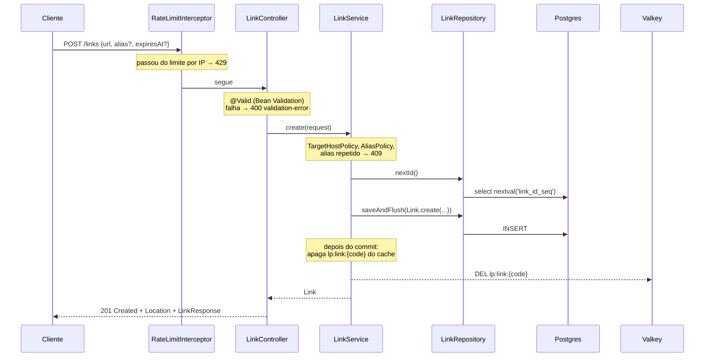
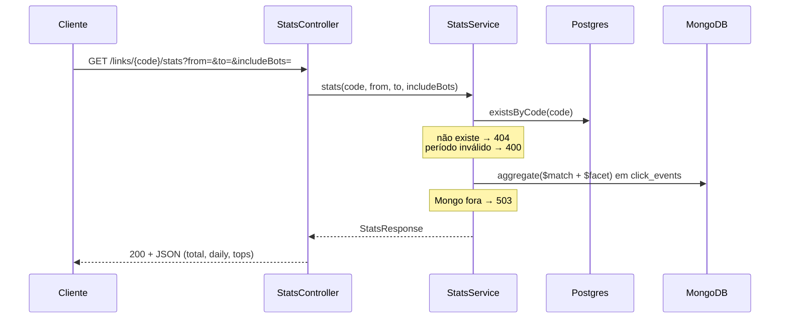

# 01 · Estrutura e fluxo de requisições

**Em uma frase:** o Link Pulse é uma API Spring Boot organizada por funcionalidade. `POST /links` grava um link no Postgres; `GET /{code}` procura o destino primeiro no cache (Valkey), responde 302 e publica o clique numa fila; `GET /links/{code}/stats` soma os cliques guardados no MongoDB.

## O que você vai aprender

- O que é uma API e o que significam "requisição", "resposta" e "status HTTP".
- Como o repositório está organizado e onde fica cada coisa.
- O caminho completo, passo a passo, de cada um dos três endpoints.
- Quais respostas de erro existem e quem as produz.

## Antes de começar: conceitos

### O que é uma API

Um site comum devolve páginas para uma pessoa ler. Uma **API** devolve dados para **outro programa** usar. O Link Pulse não tem telas: quem fala com ele é um programa (o `curl`, o Postman, o navegador seguindo um link, a Swagger UI).

A conversa acontece por **HTTP**, a mesma linguagem da web:

- O cliente manda uma **requisição** (*request*) com um **método** (`GET` para ler, `POST` para criar), um **caminho** (`/links`) e, às vezes, um **corpo** em JSON.
- O servidor devolve uma **resposta** (*response*) com um **status** (um número de três dígitos), **headers** (informações extras, como `Location`) e, às vezes, um corpo.

Os status que você vai ver neste projeto:

| Faixa | Significado | Exemplos aqui |
|-------|-------------|---------------|
| 2xx | Deu certo | `201 Created` (link criado), `200 OK` (estatísticas) |
| 3xx | "Vá para outro lugar" | `302 Found` (o redirect do link curto) |
| 4xx | O cliente pediu algo errado | `400` (dado inválido), `404` (não existe), `409` (alias repetido), `410` (expirou), `429` (pedidos demais) |
| 5xx | O servidor falhou | `500` (erro inesperado), `503` (um banco está fora) |

### API sem frontend e sem login

O projeto é só backend. Não há páginas, login nem usuários: qualquer um pode criar links e ver estatísticas. É uma escolha de escopo de portfólio, registrada no `.planning/PROJECT.md`.

### Camadas: controller, service, repository

Pense num restaurante:

- O **garçom** (controller) recebe o pedido, confere se faz sentido e entrega o prato.
- O **cozinheiro** (service) aplica as regras: o que entra no prato, em que ordem.
- O **estoquista** (repository) busca e guarda os ingredientes na despensa (o banco de dados).

No código:

- **Controller:** recebe o HTTP, transforma o JSON em objeto Java, valida e monta a resposta.
- **Service:** aplica as regras de negócio e coordena a transação com o banco.
- **Repository:** lê e grava no banco.

Quando algo dá errado ("esse link não existe"), o service **lança uma exceção**, e um tratador central (o `GlobalExceptionHandler`) a transforma numa resposta HTTP de erro.

### Organização por funcionalidade × por camada

Há dois jeitos comuns de montar pastas (que em Java se chamam **pacotes**):

- **Por camada técnica:** `controllers/`, `services/`, `repositories/`. Tudo sobre links fica espalhado em três pastas.
- **Por funcionalidade:** `link/`, `cache/`, `click/`, `stats/`. Tudo sobre um assunto fica junto.

O Link Pulse usa a segunda forma. Só o que é transversal (configuração, tratamento de erro) fica em pacotes próprios.

## No Link Pulse

### Mapa do repositório

```text
.
├── .github/            # CI (workflows/ci.yml) e Dependabot (dependabot.yml), guias 08 e 11
├── .planning/          # Planejamento: ROADMAP, STATE e os planos de cada fase
├── app/                # A aplicação Java (projeto Maven)
├── estudos/            # Estes guias
├── .gitattributes      # Fim de linha por tipo de arquivo (LF/CRLF), guia 07
├── .gitignore
├── Makefile            # Atalhos: help, build, test, verify, run, db-up, db-down
├── README.md           # Documentação principal da API
└── compose.dev.yaml    # Postgres 18, Valkey 8.1 e MongoDB 8.0 locais, guia 09
```

Dentro de `app/`:

```text
app/
├── .mvn/wrapper/maven-wrapper.properties  # Versão fixa do Maven + SHA-256 (guia 07)
├── config/
│   ├── checkstyle/checkstyle.xml          # Regras de estilo
│   └── spotbugs/exclude.xml               # Exclusões justificadas do SpotBugs
├── mvnw / mvnw.cmd                        # Maven wrapper (Git Bash e Windows)
├── pom.xml                                # Dependências e plugins
└── src/
    ├── main/java/dev/linkpulse/           # Código da aplicação
    ├── main/resources/                    # application*.yml e changelogs do Liquibase
    └── test/java/dev/linkpulse/           # Testes unitários (*Test) e de integração (*IT)
```

### Os pacotes `dev.linkpulse.*`

Um **pacote** é uma pasta de classes Java com nome em pontos. `dev.linkpulse.link` é a pasta `dev/linkpulse/link/`.

| Pacote | Principais classes | Para que serve | Guia |
|--------|--------------------|----------------|------|
| `dev.linkpulse` | `LinkPulseApplication` | Ponto de entrada: o `main` que liga tudo | 02 |
| `dev.linkpulse.config` | `ApplicationConfig`, `LinkPulseProperties`, `RedisConfig`, `MongoConfig`, `ClickConfig`, `WebMvcConfig`, `OpenApiConfig` | Monta os objetos de infraestrutura e lê a configuração `linkpulse.*` | 02 |
| `dev.linkpulse.common` | `GlobalExceptionHandler`, `IpHasher` | Tradução central de erros; hash do IP do cliente | 05, 13 |
| `dev.linkpulse.common.validation` | `HttpUrl`, `HttpUrlValidator` | Regra própria de validação de URL | 05 |
| `dev.linkpulse.link` | `LinkController`, `RedirectController`, `LinkService`, `RedirectService`, `LinkRepository`, `Link`, `CodeGenerator`, `AliasPolicy`, `TargetHostPolicy`, `LinkProblems` e os DTOs | Criar e resolver links | 01, 03, 04, 05 |
| `dev.linkpulse.cache` | `LinkCache`, `CacheEntry`, `ValkeyAvailability` | Cache do redirect no Valkey e o "disjuntor" para quando ele cai | 12 |
| `dev.linkpulse.click` | `ClickPublisher`, `ClickStreamConsumer`, `ClickDocument`, `MongoClickEventWriter`, `ClickIndexes`, `ReferrerNormalizer`, `UserAgentClassifier` | Registrar cada clique e gravá-lo no MongoDB | 13 |
| `dev.linkpulse.stats` | `StatsController`, `StatsService`, `StatsPeriod`, `StatsResponse`, `StatsProblems` | Estatísticas de cliques por link | 14 |
| `dev.linkpulse.ratelimit` | `RateLimiter`, `RateLimitInterceptor`, `RateLimitProblems` | Limite de criações de link por IP | 15 |

### Fluxo 1: criar um link (`POST /links`)

O cliente manda:

```json
{ "url": "https://example.com/promo", "alias": "minha-promo", "expiresAt": "2026-12-31T23:59:59Z" }
```

Só `url` é obrigatória. `alias` é um código escolhido pelo cliente; `expiresAt` é quando o link deixa de funcionar.



Passo a passo:

1. **Rate limit.** Antes de chegar ao controller, o `RateLimitInterceptor` conta quantas criações aquele IP fez no último minuto. Passou de 20, a resposta é `429` (guia 15).
2. **Validação.** `LinkController.create` recebe `@Valid @RequestBody CreateLinkRequest`. `@RequestBody` diz "transforme o JSON do corpo neste objeto"; `@Valid` diz "confira as regras dele". Se uma regra falha, o método nem roda e a resposta é `400` (guia 05).
3. **Regras de domínio.** `LinkService.create` confere o destino com o `TargetHostPolicy` (o link não pode apontar para o próprio encurtador) e, se veio alias, o formato e as palavras reservadas com o `AliasPolicy`. Depois pergunta ao banco se o alias já existe (`existsByCode`); se existe, a resposta é `409`.
4. **Número novo.** `LinkRepository.nextId()` pede ao Postgres o próximo número da sequência `link_id_seq` (guia 03).
5. **Código curto.** O código é o alias ou `CodeGenerator.encode(id)`, que transforma o número em 7 caracteres embaralhados (guia 04).
6. **Gravação.** `repository.saveAndFlush(...)` grava na tabela `links` na hora.
7. **Limpeza do cache.** Depois que a gravação é confirmada (*commit*), o service apaga a chave `lp:link:{code}` do Valkey. Por quê: alguém pode ter pedido esse código antes de ele existir, e o cache guardou "não existe" (guia 12).
8. **Resposta.** O controller monta a URL curta a partir de `linkpulse.base-url` e responde `201 Created` com o header `Location` e o JSON do link.

O trecho central do service:

`app/src/main/java/dev/linkpulse/link/LinkService.java`

```java
    @Transactional
    public Link create(CreateLinkRequest request) {
        targetHostPolicy.check(request.url());
        String alias = request.alias();
        if (alias != null) {
            aliasPolicy.check(alias);
            if (repository.existsByCode(alias)) {
                throw LinkProblems.aliasConflict(alias);
            }
        }
        long id = repository.nextId();
        String code = alias != null ? alias : codeGenerator.encode(id);
        // ...
        Link saved;
        try {
            saved = repository.saveAndFlush(Link.create(id, code, request.url(), expiresAt, now));
        } catch (DataIntegrityViolationException e) {
            if (alias != null && isCodeConflict(e)) {
                throw LinkProblems.aliasConflict(alias);
            }
            // Código gerado colidindo é impossível (D-05): se acontecer, é bug e vira 500.
            throw e;
        }
        TransactionSynchronizationManager.registerSynchronization(
                new EvictAfterCommit(linkCache, code));
        return saved;
    }
```

Leitura guiada:

- **`@Transactional`** abre uma **transação**: tudo o que acontece no banco dentro do método vale junto ou não vale nada. Se der erro no meio, nada fica gravado pela metade.
- **`throw LinkProblems.aliasConflict(alias)`** interrompe o método e "joga" um erro para cima. Quem o pega é o `GlobalExceptionHandler`, que responde `409`.
- **O `try/catch`** existe por causa da **corrida de alias**: duas pessoas pedem o mesmo alias no mesmo instante, e as duas passam pelo `existsByCode` ("não existe"). Só uma consegue gravar; a outra bate na regra de unicidade da tabela (`uk_links_code`). O `catch` reconhece esse caso e devolve `409` também. O `LinkApiIT` testa isso em `concurrentCreationsOfTheSameAliasYieldOneSuccessAndConflicts`.
- **`registerSynchronization(new EvictAfterCommit(...))`** agenda a limpeza do cache para **depois** do commit. Se fosse antes, um `GET` simultâneo poderia ler o banco ainda sem o link e gravar "não existe" de novo.

E o controller:

`app/src/main/java/dev/linkpulse/link/LinkController.java`

```java
    public ResponseEntity<LinkResponse> create(@Valid @RequestBody CreateLinkRequest request) {
        Link link = linkService.create(request);
        URI shortUrl = UriComponentsBuilder.fromUri(properties.baseUrl())
                .pathSegment(link.getCode())
                .build()
                .toUri();
        return ResponseEntity.created(shortUrl).body(LinkResponse.from(link, shortUrl));
    }
```

`ResponseEntity.created(shortUrl)` monta o `201` com o header `Location`. A URL curta sai sempre de `linkpulse.base-url` e nunca do header `Host` da requisição: assim, um cliente não consegue forjar a URL devolvida.

### Fluxo 2: alguém clica no link (`GET /{code}`)

Este é o **caminho quente** (*hot path*): o endpoint mais chamado, que precisa ser o mais rápido.

```mermaid
sequenceDiagram
    participant C as Cliente
    participant RC as RedirectController
    participant RS as RedirectService
    participant LC as LinkCache
    participant V as Valkey
    participant S as LinkService
    participant DB as Postgres
    participant P as ClickPublisher

    C->>RC: GET /{code}
    Note over RC: regex [A-Za-z0-9_-]+<br/>"." ou "/" nem chegam aqui
    RC->>RS: resolve(code)
    RS->>LC: get(code)
    LC->>V: GET lp:link:{code}
    alt achou no cache (hit)
        LC-->>RS: Found / Missing / Gone
    else não achou (miss) ou Valkey fora
        RS->>S: find(code)
        S->>DB: SELECT ... WHERE code = ?
        RS->>LC: putFound / putMissing / putGone
    end
    Note over RS: não existe → 404<br/>expirou → 410
    RS-->>RC: targetUrl
    RC->>P: publish(code, ip, referer, userAgent)
    Note over P: só entrega a uma fila;<br/>não espera o Valkey
    RC-->>C: 302 Location + Cache-Control: no-store, private
```

`app/src/main/java/dev/linkpulse/link/RedirectController.java`

```java
    @GetMapping("/{code:[A-Za-z0-9_-]+}")
    // ...
    public ResponseEntity<Void> redirect(@PathVariable String code, HttpServletRequest request) {
        String target = redirectService.resolve(code);
        if (HttpMethod.GET.matches(request.getMethod())) {
            clickPublisher.publish(code, request.getRemoteAddr(),
                    request.getHeader(HttpHeaders.REFERER),
                    request.getHeader(HttpHeaders.USER_AGENT));
        }
        return ResponseEntity.status(HttpStatus.FOUND)
                .location(URI.create(target))
                .cacheControl(CacheControl.noStore().cachePrivate())
                .build();
    }
```

Leitura guiada:

- **`@GetMapping("/{code:[A-Za-z0-9_-]+}")`**: `{code}` é uma variável no caminho, e o trecho depois dos dois-pontos é uma **regex** (um padrão de texto) que só aceita letras, dígitos, `_` e `-`. Por isso `/favicon.ico` e `/swagger-ui.html` (que têm ponto) nem chegam aqui. O `RedirectIT` prova isso em `pathWithDotIsNotRedirectRoute` e `multiSegmentPathIsNotRedirectRoute`.
- **`redirectService.resolve(code)`** descobre o destino. Primeiro no cache; se não achar, no Postgres (guia 12). Se o código não existe, lança o erro `404`; se expirou, `410`.
- **`if (HttpMethod.GET.matches(...))`**: o `@GetMapping` também atende o método `HEAD`, que navegadores e apps de mensagem usam para "espiar" um link sem abri-lo. Esses acessos não contam como clique.
- **`clickPublisher.publish(...)`** entrega o clique a uma fila em memória e volta na hora. Quem grava o clique de verdade é outro processo, depois (guia 13). O redirect nunca espera o registro do clique.
- **`HttpStatus.FOUND`** é o `302`. O header `Location` diz ao navegador para onde ir.
- **`Cache-Control: no-store, private`** proíbe o navegador e os proxies de guardar o redirect. Sem isso, um link expirado continuaria funcionando para quem já clicou antes.

### Fluxo 3: ver estatísticas (`GET /links/{code}/stats`)



O service confere no Postgres se o código existe, calcula o período (padrão: últimos 30 dias) e faz **uma única consulta** ao MongoDB, que devolve o total, os cliques por dia e os "tops" de site de origem, navegador e sistema operacional. Detalhes no guia 14.

### Todas as respostas HTTP

| Status | Quando | `type` do erro | Quem produz |
|--------|--------|----------------|-------------|
| 201 | Link criado | — | `LinkController` |
| 200 | Estatísticas | — | `StatsController` |
| 302 | Código existe e não expirou | — | `RedirectController` |
| 400 | Campo inválido (URL, alias, `expiresAt` no passado, host recusado) | `/problems/validation-error` | `GlobalExceptionHandler`, `LinkProblems` |
| 400 | JSON malformado ou campo em formato errado | `/problems/malformed-request` | `GlobalExceptionHandler` |
| 400 | Parâmetro de query/caminho em formato errado (`from=2026-13-01`) | `/problems/invalid-parameter` | `GlobalExceptionHandler` |
| 400 | Período de estatísticas inválido | `/problems/invalid-period` | `StatsProblems` |
| 404 | Código inexistente | `/problems/link-not-found` | `LinkProblems` |
| 409 | Alias já existe | `/problems/alias-conflict` | `LinkProblems` |
| 410 | Link expirado | `/problems/link-expired` | `LinkProblems` |
| 429 | Criações demais do mesmo IP | `/problems/rate-limited` | `RateLimitProblems` |
| 500 | Erro inesperado (detalhe só no log) | `/problems/internal-error` | `GlobalExceptionHandler` |
| 503 | MongoDB fora ao pedir estatísticas | `/problems/stats-unavailable` | `StatsProblems` |

O formato desses erros (Problem Details) está no guia 05.

## Por que assim?

- **O ID existe antes do INSERT.** O código curto é calculado a partir do número da sequência, então ele já existe antes de gravar, e um único INSERT grava número e código juntos (guia 03).
- **Checagem prévia + regra no banco.** O `existsByCode` responde rápido no caso comum; a constraint `uk_links_code` é a garantia final quando duas requisições chegam juntas.
- **302 com `no-store`, e não 301.** Um `301` (permanente) pode ser guardado pelo navegador para sempre, e o link continuaria funcionando depois de expirar.
- **Clique fora do caminho do redirect.** Gravar o clique no MongoDB antes de responder deixaria cada redirect mais lento e faria o redirect falhar quando o MongoDB caísse. Com a fila, o redirect só depende de achar o destino.
- **Nada de URL de destino em log.** O javadoc do `LinkService` avisa que "query strings podem carregar tokens e dados pessoais".

## Experimente

Com a API rodando (`make run`; o guia 09 mostra como fazer no cmd e no PowerShell), num terminal Git Bash ou WSL:

```bash
curl -i http://localhost:8080/demo-link
```

Saída documentada no README:

```text
# HTTP/1.1 302
# Location: https://example.com/
# Cache-Control: no-store, private
```

Crie um link e depois um com alias e expiração (comandos do README):

```bash
curl -i -X POST http://localhost:8080/links \
  -H 'Content-Type: application/json' \
  -d '{"url":"https://example.com/artigo"}'

curl -i -X POST http://localhost:8080/links \
  -H 'Content-Type: application/json' \
  -d '{"url":"https://example.com/promo","alias":"minha-promo","expiresAt":"2026-12-31T23:59:59Z"}'
```

Exercícios:

1. Repita o segundo `POST` e observe o `409 alias-conflict`.
2. Peça `curl -i http://localhost:8080/Minha-Promo` e explique o `404` (o código diferencia maiúsculas de minúsculas).
3. Peça `curl -i http://localhost:8080/favicon.ico` e compare o corpo com o de um código inexistente.
4. Clique três vezes em `/minha-promo` e depois peça `curl -s 'http://localhost:8080/links/minha-promo/stats?includeBots=true'`. Por que o `includeBots=true`? (Dica: guia 14.)
5. Abra a Swagger UI em <http://localhost:8080/swagger-ui.html> e encontre os três endpoints.

## Perguntas para fixar

1. Em que ordem `LinkService.create` chama `TargetHostPolicy`, `AliasPolicy`, `existsByCode` e `nextId`?
2. Se duas requisições com o mesmo alias passam juntas pelo `existsByCode`, o que garante que só uma é gravada?
3. Por que `/favicon.ico` não chega ao `RedirectController`?
4. Por que um `HEAD /{code}` não conta como clique?
5. Por que o redirect não espera o clique ser gravado no MongoDB?

<details>
<summary>Respostas</summary>

1. Primeiro o `TargetHostPolicy`, depois (se houver alias) o `AliasPolicy` e o `existsByCode`, e por fim o `nextId`. As checagens baratas vêm antes de gastar um número da sequência.
2. A constraint `uk_links_code` da tabela `links`: o segundo INSERT falha, e o `catch` transforma a falha em `409`.
3. A regex do caminho (`[A-Za-z0-9_-]+`) não aceita ponto.
4. O controller só publica quando o método é `GET`. `HEAD` vem de prefetch e de preview de link, não de uma pessoa clicando.
5. Para o redirect ficar rápido e continuar funcionando mesmo com o MongoDB fora. O clique vai para uma fila e é gravado depois.

</details>

---

[← Anterior: 00 · Visão geral](00-visao-geral-do-projeto.md) · [Índice](README.md) · [Próximo: 02 · Spring Boot e Java 21 →](02-spring-boot-e-java-21.md)
