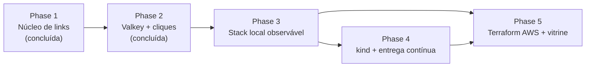

# 10 · Próximas fases

**Em uma frase:** nada deste guia existe ainda no código. Ele resume o plano das Phases 3 a 5 descrito no [ROADMAP](../.planning/ROADMAP.md), para você saber o que estudar antes de cada uma.

## O que você vai aprender

- Onde o projeto está e para onde ele vai.
- O que é cada tecnologia das próximas fases, explicada do zero: imagem Docker, Prometheus, Grafana, k6, Kubernetes, Helm, Terraform e LocalStack.
- O que estudar antes de cada fase.

## Como ler este guia

Os guias 01 a 09 e 11 a 16 descrevem o repositório como ele é hoje (Phases 1 e 2 concluídas). Este guia descreve o que está **planejado**. As fontes são o `.planning/ROADMAP.md` (objetivo e critérios de sucesso de cada fase), a tabela "Decisões Importantes" do `.planning/PROJECT.md` e a pesquisa de stack do `.claude/CLAUDE.md`. Detalhes de implementação podem mudar quando cada fase for planejada; quando o ROADMAP não diz algo, este guia também não diz.

### Linha do tempo

A ordem prevista é 3 → 4 → 5, e a parte de Terraform da Phase 5 pode começar logo depois da Phase 3.

### O que a Phase 2 entregou

A Phase 2 ("Hot path no Valkey e pipeline de cliques") virou cinco guias:

| Entrega | Guia |
|---------|------|
| Cache do redirect no Valkey, com fail-open | [12](12-cache-valkey-e-fail-open.md) |
| Cliques publicados num stream e gravados no MongoDB | [13](13-pipeline-de-cliques.md) |
| `GET /links/{code}/stats` | [14](14-estatisticas-no-mongodb.md) |
| Rate limit do `POST /links` | [15](15-rate-limit-por-ip.md) |
| Métricas em `/actuator/prometheus` | [16](16-metricas-com-micrometer.md) |

## Phase 3: Stack local observável

**Objetivo (ROADMAP):** um avaliador roda `make up`, popula dados de demonstração e vê o encurtador funcionando com métricas reais em dashboards e alertas versionados, com o desempenho comprovado por teste de carga.

Hoje, `make run` sobe só os bancos em containers, e a API roda pelo Maven (guia 09). A Phase 3 coloca **tudo** em containers, inclusive a API, o monitoramento e os painéis.

- **Imagem Docker da aplicação (multi-stage).** O que é: um `Dockerfile` é a "receita" de uma imagem. *Multi-stage* quer dizer em etapas: uma etapa compila o projeto (com o JDK completo) e outra, bem menor, só leva o necessário para rodar (o JRE e o jar). O *layered jar* separa as bibliotecas (que quase nunca mudam) do código do projeto (que muda sempre), para o Docker reaproveitar camadas e reconstruir mais rápido. Como vai entrar: imagem com usuário sem privilégios de administrador e `HEALTHCHECK` (critério 1).
- **`make up`.** Vai subir a API, o Postgres, o MongoDB, o Valkey, o Prometheus e o Grafana na ordem certa, esperando os healthchecks (guia 09).
- **Prometheus.** O que é: o banco de séries temporais que visita o `/actuator/prometheus` de tempos em tempos e guarda os números (guia 16). Também avalia **regras de alerta**. Como vai entrar: alertas de taxa de erros 5xx, latência p99 alta, atraso do consumer de cliques e "alvo fora do ar", cada um com um **runbook** (um roteiro do que fazer quando o alerta dispara) (critério 3).
- **Grafana.** O que é: a ferramenta de painéis (dashboards) com gráficos a partir do Prometheus. Como vai entrar: painéis guardados como arquivos na pasta `observability/` (taxa de requisições, p95/p99, hit ratio do cache, cliques por minuto e saúde do pipeline), carregados sem nenhuma configuração manual.
- **k6.** O que é: uma ferramenta de **teste de carga**, que simula muitos usuários ao mesmo tempo, com scripts em JavaScript e *thresholds* (limites que reprovam o teste, como "p95 acima de 50 ms = falhou"). Como vai entrar: cenários de redirect e de criação contra o compose, **sem seguir redirects**. Senão o k6 passaria a medir o site de destino (`example.com`) em vez da API (critério 5).

**O que estudar antes:** Dockerfile multi-stage, Docker Compose com `depends_on` e healthchecks, PromQL (a linguagem de consulta do Prometheus: `rate`, `histogram_quantile`), provisioning do Grafana, k6 (`scenarios`, `thresholds`).

## Phase 4: Kubernetes no kind e entrega contínua

**Objetivo (ROADMAP):** um avaliador roda `make k8s` e obtém o mesmo encurtador observável num cluster kind, enquanto o CI publica uma imagem escaneada no GHCR e comprova o deploy com um smoke test.

- **Kubernetes.** O que é: um "orquestrador" de containers. Você descreve o estado desejado ("quero 2 cópias da API, cada uma com até 512 MB") e ele cuida do resto: sobe os containers, reinicia os que caem, cria mais cópias quando a carga sobe e distribui o tráfego. As peças básicas são o **Pod** (um ou mais containers juntos), o **Deployment** (quantas cópias de um Pod manter), o **Service** (um endereço fixo para chegar aos Pods) e o **Ingress** (a porta de entrada vinda de fora).
- **kind.** O que é: *Kubernetes in Docker*, um Kubernetes de verdade rodando dentro de containers, para usar na sua máquina e no CI. Como vai entrar: `make k8s` cria o cluster e instala tudo.
- **Helm.** O que é: o "gerenciador de pacotes" do Kubernetes. Um **chart** é um conjunto de modelos de configuração com valores ajustáveis por ambiente. Como vai entrar: um chart da aplicação com Deployment, Service, Ingress, ConfigMap, Secret e HPA (o **autoscaler**, que cria mais cópias quando a CPU sobe), com valores para dev e prod (critério 2).
- **Traefik.** O que é: um proxy reverso que atua como controlador de Ingress, a "recepção" que direciona o tráfego de fora para os serviços certos. Como vai entrar: expõe a aplicação no kind. Substitui o ingress-nginx, aposentado em março de 2026 (`.planning/PROJECT.md`). É aqui que o `SERVER_TOMCAT_REMOTEIP_INTERNAL_PROXIES` ganha a faixa de IPs do Traefik (guia 15).
- **kube-prometheus-stack.** O que é: um chart que instala Prometheus, Grafana e Alertmanager dentro do cluster. Como vai entrar: o Prometheus descobre a aplicação sozinho (via ServiceMonitor), com os mesmos painéis e alertas da pasta `observability/` (critério 3).
- **Probes.** O que é: perguntas que o Kubernetes faz periodicamente ao Pod. A **readiness** ("está pronto para receber tráfego?") e a **liveness** ("está vivo, ou devo reiniciar?"). Como vai entrar: o Pod só recebe tráfego com Postgres e Valkey acessíveis, mas uma queda do Valkey ou do MongoDB **não** reinicia o Pod. A liveness não depende de serviços externos, senão uma queda do banco reiniciaria todas as cópias da API à toa (critério 2).
- **GHCR, Trivy e SBOM.** O GitHub Container Registry guarda as imagens Docker; o Trivy procura vulnerabilidades conhecidas nelas; o SBOM (*software bill of materials*) é a "lista de ingredientes" da imagem. Como vai entrar: publicação a cada push na `main` e um job do CI que sobe um kind e passa no smoke test "criar link → redirect → stats" (critérios 4 e 5).

**O que estudar antes:** objetos básicos do Kubernetes (Pod, Deployment, Service, Ingress, ConfigMap, Secret, HPA), probes de liveness e readiness, Helm (templates e values), Prometheus Operator e ServiceMonitor.

## Phase 5: Terraform AWS e vitrine

**Objetivo (ROADMAP):** o avaliador encontra a infraestrutura AWS da aplicação descrita em Terraform e validada em camadas a custo zero, e um README em português que conta a história do projeto com evidências.

- **Terraform.** O que é: uma ferramenta de **infraestrutura como código**. Em vez de criar servidores, redes e bancos clicando no console da AWS, você os descreve em arquivos de texto (na linguagem HCL); o Terraform calcula o que mudar (`plan`) e aplica (`apply`). A infraestrutura passa a ter histórico no Git e revisão em PR, como o código. Como vai entrar: módulos de rede, ECR (registro de imagens), ECS Fargate (containers gerenciados) + ALB (balanceador de carga), RDS Postgres, ElastiCache Valkey e segredos (critério 1).
- **Validação em camadas, sem gastar dinheiro.**
  - Em todo PR: `fmt` (formatação), `validate` (sintaxe) e `tflint` (erros comuns).
  - `terraform test` com `mock_provider "aws"`: testa os módulos fingindo a AWS, sem credencial nem custo (critério 2).
  - **LocalStack:** um simulador da AWS que roda num container. Com um token do plano gratuito (Hobby), um `apply` de verdade só da parte que esse plano suporta: rede, IAM (permissões), logs e segredos (critério 3). Sem o token, esse passo é pulado sem falhar. O motivo, segundo o `PROJECT.md`: o LocalStack gratuito não inclui ECS, RDS, ElastiCache nem ECR desde março de 2026.
- **README vitrine.** Diagrama de arquitetura, `make up` e `make k8s`, resultados do k6, imagens dos painéis e as decisões de projeto com prós e contras: 302 vs 301, Valkey, coleção normal vs time-series, Terraform em camadas, a escolha do Spring Boot e o MongoDB na AWS via DocumentDB ou Atlas (critério 4).

**O que estudar antes:** fundamentos de AWS (VPC, subnets, security groups, IAM), HCL e módulos do Terraform, `terraform test`, conceitos de ECS Fargate e RDS.

## Por que nessa ordem?

- **De dentro para fora:** a visão geral do ROADMAP explica a ordem. Primeiro a verdade do link no Postgres (Phase 1), depois o caminho quente e o pipeline de cliques ("a parte de maior risco técnico, atacada cedo", Phase 2), depois a stack observável, o Kubernetes e, por fim, Terraform e README.
- **Custo zero:** LocalStack Hobby + `mock_provider`, GHCR e kind permitem demonstrar tudo sem uma conta AWS paga (`PROJECT.md`).
- **Mesmas versões em todos os ambientes:** Valkey e Postgres nas mesmas versões no compose, no kind e na AWS.

## Experimente

1. Abra o `.planning/ROADMAP.md` e encontre, para cada fase, os requisitos listados em **Requirements** (`OBS-02`, `K8S-01`...).
2. Escolha um critério de sucesso da Phase 3 e diga quais métricas do guia 16 ele vai usar.
3. Leia a seção "LEIA PRIMEIRO" do `.claude/CLAUDE.md` e explique, com suas palavras, por que o projeto não usa ingress-nginx nem os charts da Bitnami.

## Perguntas para fixar

1. Por que o teste de carga do redirect não deve seguir redirects?
2. Qual a diferença entre a readiness probe e a liveness probe?
3. Por que a liveness probe não deve depender do Valkey nem do MongoDB?
4. O que significa "infraestrutura como código"?
5. Quais partes do Terraform serão aplicadas no LocalStack Hobby, e quais só serão testadas com `mock_provider`?

Respostas

1. Porque o k6 passaria a medir o site de destino em vez da API. Com `redirects: 0`, ele confere só o `302`.
2. A readiness responde "posso receber tráfego?"; a liveness responde "estou vivo, ou preciso ser reiniciado?".
3. Porque uma queda deles reiniciaria todos os Pods da API sem motivo; a API continua funcionando sem eles (fail-open), e reiniciar não conserta o banco.
4. Descrever a infraestrutura em arquivos de texto versionados, aplicados por uma ferramenta, em vez de criá-la à mão num console.
5. No LocalStack Hobby: rede, IAM, logs e segredos. Só com `mock_provider`: ECS, RDS, ElastiCache e ECR.

---

[← Anterior: 16 · Métricas](16-metricas-com-micrometer.md) · [Índice](README.md)
