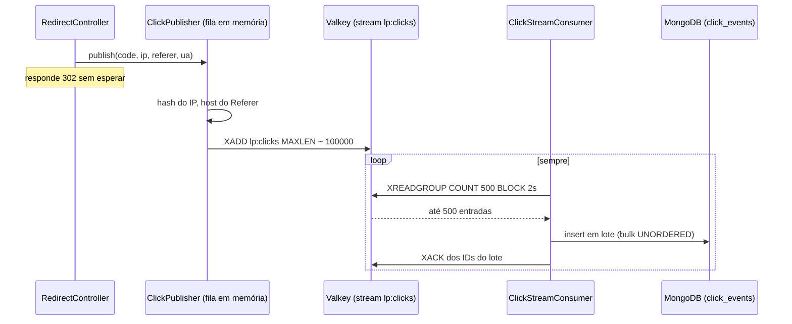

# 13 · Pipeline de cliques: Redis Streams e MongoDB

**Em uma frase:** cada redirect deixa um "recado" do clique numa fila em memória e responde na hora. Uma thread de fundo manda o recado para um stream do Valkey, e um consumer lê o stream em lotes e grava os cliques no MongoDB, confirmando cada lote só depois de gravado, sem perder nem duplicar cliques.

## O que você vai aprender

- O que é processamento assíncrono e por que o redirect não grava o clique na hora.
- O que são Redis Streams, consumer groups, `XADD`, `XREADGROUP`, `XACK` e a lista de pendentes.
- O que significa entrega "at-least-once" e como o projeto evita duplicatas.
- Como o IP, o Referer e o user-agent são tratados para proteger a privacidade.
- Como os cliques ficam guardados no MongoDB.

## Antes de começar: conceitos

### Síncrono × assíncrono

- **Síncrono:** você faz um pedido e **espera** a resposta antes de seguir. Como um telefonema.
- **Assíncrono:** você deixa o pedido e **segue a vida**; alguém o processa depois. Como deixar um bilhete na caixa de correio.

Gravar o clique no MongoDB **durante** o redirect deixaria cada redirect mais lento e faria o redirect falhar quando o MongoDB caísse. Por isso o clique é registrado de forma assíncrona: o redirect só deixa o bilhete e responde 302.

### Produtor, fila e consumidor

**Analogia: a cozinha de uma lanchonete.**

- O **garçom** (produtor) anota o pedido num papel e o prende num **trilho de pedidos** (a fila). Ele não espera o lanche ficar pronto.
- O **cozinheiro** (consumidor) pega vários papéis de uma vez, prepara tudo e só então tira os papéis do trilho.
- Se o cozinheiro passar mal no meio do preparo, os papéis continuam no trilho, e outro cozinheiro os pega.

No projeto: o `RedirectController` é o garçom; o stream `lp:clicks` do Valkey é o trilho; o `ClickStreamConsumer` é o cozinheiro; o MongoDB é onde os lanches prontos ficam.

### Redis Streams

Um **stream** é uma estrutura do Valkey/Redis que funciona como um **registro de eventos só de acréscimo**: cada evento novo entra no fim, com um **ID** gerado pelo servidor no formato `<milissegundos>-<sequência>` (por exemplo, `1760198400000-0`).

| Comando | Analogia | O que faz |
|---------|----------|-----------|
| `XADD` | prender um papel no trilho | Acrescenta uma entrada ao stream |
| `XREADGROUP` | o cozinheiro pega papéis | Lê entradas novas em nome de um consumidor de um grupo |
| `XACK` | tirar o papel do trilho | Confirma que a entrada foi processada |
| `XPENDING` | olhar papéis "pegos e esquecidos" | Lista entradas lidas e ainda não confirmadas |
| `XCLAIM` | outro cozinheiro assume o papel | Transfere uma entrada pendente para outro consumidor |
| `XLEN` | contar papéis | Tamanho do stream |

### Consumer group e PEL

Um **consumer group** (grupo de consumidores) é um grupo de "cozinheiros" que dividem o trabalho: cada entrada é entregue a **um** deles. O grupo lembra até onde já leu.

Quando um consumidor lê uma entrada, ela vai para a **PEL** (*Pending Entries List*, lista de pendentes): "entregue, mas ainda não confirmada". Só o `XACK` a tira de lá. Se o consumidor morrer antes do `XACK`, a entrada fica na PEL, e outro consumidor pode assumi-la com `XCLAIM`.

### At-least-once e idempotência

- **At-least-once ("pelo menos uma vez"):** nenhum clique se perde, mas um clique pode ser **entregue duas vezes** (por exemplo, o consumidor gravou e morreu antes do `XACK`; a entrada volta e é gravada de novo).
- **Idempotência:** fazer a mesma operação duas vezes tem o mesmo efeito que fazer uma. Se a gravação for idempotente, entregar duas vezes não cria clique duplicado.

O projeto combina os dois: entrega at-least-once + gravação idempotente = cada clique gravado **exatamente uma vez**.

### MongoDB

O **MongoDB** é um banco de **documentos**: guarda registros parecidos com JSON, numa **coleção** (o equivalente a uma tabela, mas sem esquema rígido). Ele combina com eventos de clique: são muitos, simples, só crescem e são somados depois (guia 14).

Todo documento tem um campo `_id` único. Gravar um segundo documento com o mesmo `_id` dá o erro **duplicate key** (código 11000). É essa regra que torna a gravação idempotente.

## No Link Pulse

### O caminho completo



### Etapa 1: o publisher (o garçom não espera)

O controller chama `clickPublisher.publish(...)` só depois de o código resolver, e só para `GET` (guia 01).

`app/src/main/java/dev/linkpulse/click/ClickPublisher.java`

```java
    public void publish(String code, String remoteAddr, String referer, String userAgent) {
        if (!running) {
            rejected.increment();
            return;
        }
        Instant ts = clock.instant();
        // Fila cheia (ou executor já desligado) cai no handler de rejeição, que só conta.
        executor.execute(() -> send(code, remoteAddr, referer, userAgent, ts));
    }
```

A thread do redirect só anota o horário (`ts`) e entrega a tarefa a um **executor**: um pequeno grupo de 2 threads próprias com uma fila de até 10.000 tarefas (`linkpulse.clicks.publisher.*`). O método **nunca bloqueia nem lança exceção**:

- fila cheia → o clique é descartado e contado como `rejected`;
- Valkey fora ou disjuntor aberto (guia 12) → o clique é descartado e contado como `failed`.

Por que um executor próprio e não o `@Async` do Spring? O javadoc explica: com virtual threads, o executor padrão "não tem limite nem backpressure". Uma fila sem limite poderia engolir toda a memória se o Valkey ficasse lento. **Backpressure** é justamente isso: um mecanismo que segura a entrada quando a saída não dá conta.

Na thread do executor, o método `send` monta a entrada e faz o `XADD`:

```java
        Map<String, String> fields = Map.of(
                FIELD_CODE, code,
                FIELD_TS, Long.toString(ts.toEpochMilli()),
                FIELD_REF, ReferrerNormalizer.toHost(referer),
                FIELD_UA, truncate(userAgent),
                FIELD_IPH, ipHasher.hash(remoteAddr, ts));
        try {
            redis.opsForStream().add(MapRecord.create(clicks.streamKey(), fields),
                    RedisStreamCommands.XAddOptions.maxlen(clicks.maxLen())
                            .approximateTrimming(true));
```

| Campo | Conteúdo |
|-------|----------|
| `code` | o código curto |
| `ts` | o instante do clique, em milissegundos desde 1970 (*epoch*) |
| `ref` | só o **host** do Referer, ou `(direct)` |
| `ua` | o user-agent, cortado em 512 caracteres |
| `iph` | o **hash** do IP, nunca o IP |

`MAXLEN ~ 100000` limita o stream a cerca de 100 mil entradas: o Valkey apaga as mais antigas para o stream não crescer sem limite. O `~` ("aproximado") deixa o Valkey cortar de forma eficiente, sem ser exato.

### Privacidade: o que nunca sai da memória

O IP e o Referer completo são **dados pessoais**. O projeto os transforma antes do `XADD`, e o original nunca é publicado, gravado em log nem usado em métricas.

**O IP vira um HMAC** (`app/src/main/java/dev/linkpulse/common/IpHasher.java`):

```java
    public String hash(String ip, Instant at) {
        String day = LocalDate.ofInstant(at, ZoneOffset.UTC).toString();
        try {
            Mac mac = Mac.getInstance(ALGORITHM);
            mac.init(key);
            byte[] digest = mac.doFinal((day + "|" + ip).getBytes(StandardCharsets.UTF_8));
            return HexFormat.of().formatHex(digest);
```

- Um **hash** transforma um texto numa "impressão digital" de tamanho fixo, da qual não dá para voltar ao original.
- Um hash simples do IP **não basta**: só existem cerca de 4 bilhões de IPv4, e um computador calcula o hash de todos em pouco tempo, montando uma tabela de volta. Um **HMAC** é um hash com uma **chave secreta** (`linkpulse.ip-hash-key`): sem a chave, não dá para montar a tabela.
- O **dia UTC** entra no cálculo. O mesmo IP gera o mesmo hash dentro do dia (dá para contar visitantes únicos por dia) e um hash diferente no dia seguinte, o que impede seguir uma pessoa ao longo dos dias.
- A chave é **obrigatória** e precisa de pelo menos 16 caracteres. Sem ela, o construtor lança exceção e a aplicação não sobe. Em dev, o `application-dev.yml` traz uma chave fixa que "não é segredo"; fora do dev, ela vem de `LINKPULSE_IP_HASH_KEY`.

**O Referer vira só o host** (`ReferrerNormalizer.toHost`). O **Referer** é o header que diz de qual página a pessoa veio. A URL completa pode carregar tokens e e-mails (`?token=...`), então só o host sobra: `https://news.example.com/x?y=1` vira `news.example.com`. Sem Referer, ou com um valor sem host, o resultado é `(direct)`.

**O user-agent é classificado e descartado** (mais abaixo, na Etapa 3).

### Etapa 2: o consumer (o cozinheiro em lotes)

O `ClickStreamConsumer` roda um laço próprio numa **virtual thread** (guia 02), criada quando a aplicação sobe:

`app/src/main/java/dev/linkpulse/click/ClickStreamConsumer.java`

```java
    private List<MapRecord<String, Object, Object>> readBatch() {
        return redis.opsForStream().read(
                Consumer.from(settings.group(), settings.consumerName()),
                StreamReadOptions.empty().count(settings.batchSize()).block(settings.block()),
                StreamOffset.create(settings.streamKey(), ReadOffset.lastConsumed()));
    }
```

É o `XREADGROUP`: "em nome do consumidor `<nome>` do grupo `click-writers`, me dê até 500 entradas novas (`COUNT 500`); se não houver nenhuma, espere até 2 s (`BLOCK 2s`)". `ReadOffset.lastConsumed()` é o `>` do comando: "só entradas nunca entregues a ninguém".

O nome do consumidor é o `HOSTNAME` da máquina (o nome do container ou do pod), para dar para saber de quem são os pendentes. Sem ele, o nome é `lp-<uuid aleatório>`.

Depois de ler, o lote é processado:

```java
    private void process(List<MapRecord<String, Object, Object>> batch) {
        List<ClickDocument> documents = new ArrayList<>(batch.size());
        RecordId[] ids = new RecordId[batch.size()];
        for (int i = 0; i < ids.length; i++) {
            MapRecord<String, Object, Object> entry = batch.get(i);
            ids[i] = entry.getId();
            ClickDocument.fromStream(entry.getId().getValue(), entry.getValue())
                    .ifPresent(documents::add);
        }
        batchSizes.record(batch.size());

        long start = System.nanoTime();
        int duplicated;
        try {
            duplicated = writer.write(documents);
        } catch (RuntimeException e) {
            writeFailure.record(System.nanoTime() - start, TimeUnit.NANOSECONDS);
            throw e;
        }
        writeSuccess.record(System.nanoTime() - start, TimeUnit.NANOSECONDS);
        persisted.increment(documents.size() - duplicated);
        duplicates.increment(duplicated);

        redis.opsForStream().acknowledge(settings.streamKey(), settings.group(), ids);
        invalid.increment(batch.size() - documents.size());
    }
```

A regra de ouro está na ordem das duas últimas operações importantes: **primeiro grava (`writer.write`), depois confirma (`acknowledge` = `XACK`)**. Se a gravação lançar exceção, o `throw e` sai do método **antes** do `XACK`, e o lote inteiro fica na PEL para ser tentado de novo.

Entradas inválidas (um campo faltando, um formato antigo) não viram documento, mas **são confirmadas** e contadas em `linkpulse.clicks.invalid`. Se não fossem, voltariam para sempre e "envenenariam" o grupo.

Por que um laço próprio e não o `StreamMessageListenerContainer` do Spring? Ele entrega **uma mensagem por vez**, e o requisito é gravar em lote (registrado no `.claude/CLAUDE.md`).

### Gravação idempotente no MongoDB

`app/src/main/java/dev/linkpulse/click/MongoClickEventWriter.java`

```java
    public int write(List<ClickDocument> documents) {
        if (documents.isEmpty()) {
            return 0;
        }
        try {
            mongo.bulkOps(BulkOperations.BulkMode.UNORDERED, ClickDocument.class, collection)
                    .insert(documents)
                    .execute();
            return 0;
        } catch (BulkOperationException e) {
            List<BulkWriteError> errors = e.getErrors();
            boolean onlyDuplicates = !errors.isEmpty()
                    && errors.stream().allMatch(error -> error.getCode() == DUPLICATE_KEY);
            if (!onlyDuplicates) {
                throw e;
            }
            return errors.size();
        }
    }
```

- **`bulkOps`**: grava o lote inteiro numa única ida ao banco, muito mais eficiente que um insert por clique.
- **`UNORDERED`**: se um documento falhar, os outros continuam sendo gravados.
- **O `_id` do documento é o ID da entrada no stream.** Se a mesma entrada for entregue duas vezes, o segundo insert bate no `_id` repetido (`DUPLICATE_KEY` = 11000).
- **O `catch`**: se **todos** os erros do lote forem de chave duplicada, tudo bem: aqueles cliques já estavam gravados. Qualquer outro erro sobe, e o lote fica na PEL.

É aqui que at-least-once + idempotência viram "exatamente uma vez". O `ClickRedeliveryIT` simula uma queda entre o insert e o `XACK` com duplicatas misturadas e termina com o número exato de documentos.

### Reentrega: o reclaim

Uma entrada que falhou fica na PEL, mas o `XREADGROUP` com `>` só entrega entradas **novas**. Quem a traz de volta é o **reclaim**: a cada 30 s (`linkpulse.clicks.consumer.reclaim-interval`), o laço:

1. pergunta ao grupo, com `XPENDING`, quais entradas estão pendentes há pelo menos 60 s (`min-idle`);
2. assume essas entradas com `XCLAIM`;
3. passa tudo pelo mesmo `process` (grava → `XACK`).

Isso cobre um consumidor que **morreu** (outra instância, ou a mesma reiniciada) e falhas do próprio consumidor. Os 60 s existem para não "roubar" uma entrada que outra instância ainda está processando.

Nenhum clique válido é descartado por excesso de tentativas: com o MongoDB fora por muito tempo, os cliques esperam na PEL e voltam quando ele volta. O `ClickResilienceIT` pausa o MongoDB durante 3 redirects e confere que os 3 cliques chegam depois (resumo do plano 02-08: recuperação em cerca de 0,5 s após o MongoDB voltar).

A única perda possível: com um acúmulo enorme, o `MAXLEN ~ 100000` pode apagar entradas do stream antes de elas serem gravadas. O reclaim percebe, confirma essas entradas e as conta em `linkpulse.clicks.lost`, para a perda nunca ser silenciosa.

### O laço nunca morre

```java
            while (running) {
                refreshGaugesIfDue();
                try {
                    ensureIndexes();
                    ensureGroup();
                    reclaimIfDue();
                    List<MapRecord<String, Object, Object>> batch = readBatch();
                    if (batch != null && !batch.isEmpty()) {
                        process(batch);
                    }
                    // ...
                } catch (RuntimeException e) {
                    errors.increment();
                    // ...
                    backoffMillis = backoffMillis == 0
                            ? INITIAL_BACKOFF_MILLIS
                            : Math.min(backoffMillis * 2, MAX_BACKOFF_MILLIS);
                    sleepWhileRunning(backoffMillis);
                }
            }
```

Qualquer erro cai no `catch`, que conta, espera e tenta de novo. A espera cresce a cada falha seguida (0,5 s, 1 s, 2 s... até 10 s): isso se chama **backoff exponencial** e evita martelar um banco que está tentando voltar. Só a primeira falha de uma sequência vai para o log, para uma queda longa não inundar o log.

### Etapa 3: o documento em `click_events`

`app/src/main/java/dev/linkpulse/click/ClickDocument.java`

```java
@Document(ClickDocument.COLLECTION)
public record ClickDocument(@Id String id, String code, Instant ts, String referrer,
        String browser, String os, @Field("isBot") boolean bot, String ipHash) {
```

| Campo | Exemplo | Origem |
|-------|---------|--------|
| `_id` | `1760198400000-0` | o ID da entrada no stream |
| `code` | `demo-link` | campo `code` |
| `ts` | data BSON | campo `ts` |
| `referrer` | `news.example.com` | campo `ref` |
| `browser` | `Firefox` | classificado a partir do `ua` |
| `os` | `Linux` | classificado a partir do `ua` |
| `isBot` | `false` | classificado a partir do `ua` |
| `ipHash` | 64 caracteres hexadecimais | campo `iph` |

O **user-agent** é o texto que o navegador manda dizendo quem ele é (`Mozilla/5.0 ... Firefox/...`). O `UserAgentClassifier` o reduz a três informações sem versão: a família do navegador (`Chrome`, `Edge`, `Firefox`, `Safari`, `Opera`, `Samsung Internet` ou `Other`), a família do sistema (`Windows`, `macOS`, `iOS`, `Android`, `Linux`, `ChromeOS` ou `Other`) e se é um **robô** (crawlers, previews de link, `curl`, `wget`...). O texto original é descartado.

### Índices e retenção

`ClickIndexes` cria dois **índices** na coleção. Um índice funciona como o índice remissivo de um livro: em vez de ler todas as páginas, o banco vai direto ao lugar certo.

- **`code_ts`** `{code: 1, ts: -1}`: atende a consulta "cliques do código X no período Y" das estatísticas (guia 14).
- **`ts_ttl`** `{ts: 1}` com `expireAfterSeconds`: um **índice TTL**, que faz o MongoDB apagar sozinho os cliques mais antigos que `linkpulse.clicks.retention` (90 dias). Os dados não crescem para sempre.

Os índices são criados pelo laço do consumer, e não na subida da aplicação: com o MongoDB fora, a API ainda precisa subir e redirecionar.

### Timeouts do MongoDB

`app/src/main/java/dev/linkpulse/config/MongoConfig.java` reduz os tempos-limite do driver: 3 s para achar um servidor, 2 s para conectar e 5 s para ler. O padrão do driver é esperar 30 s (ou para sempre, na leitura), o que travaria o consumer e o `/stats` com o MongoDB fora.

### Desligamento organizado

Ao desligar a aplicação, a ordem importa: o servidor web para de aceitar requisições, o publisher esvazia a fila (até 5 s) **com o Valkey ainda conectado**, e o consumer termina e confirma o lote em andamento. É por isso que o `ClickPublisher` implementa `SmartLifecycle` com uma fase (`getPhase`) escolhida a dedo, e o `application.yml` dá até 30 s por fase (`spring.lifecycle.timeout-per-shutdown-phase`). O `ClickConsumerLifecycleIT` prova que o lote em andamento é gravado antes de o consumer parar.

### Métricas do pipeline

| Métrica (Prometheus) | O que mostra |
|----------------------|--------------|
| `linkpulse_clicks_publish_total{result=published\|rejected\|failed}` | Destino de cada clique na publicação |
| `linkpulse_clicks_publish_queue` | Cliques esperando na fila do publisher |
| `linkpulse_clicks_persisted_total`, `_duplicates_total`, `_invalid_total`, `_claimed_total`, `_lost_total` | O que o consumer gravou, ignorou, recuperou ou perdeu |
| `linkpulse_clicks_consumer_errors_total` | Falhas do laço do consumer |
| `linkpulse_clicks_stream_pending`, `_lag`, `_length` | Pendentes do grupo, atraso de leitura e tamanho do stream |

Essas métricas alimentam o alerta de "atraso do consumer" da Phase 3 (guias 10 e 16).

## Por que assim?

- **Assíncrono:** o redirect fica rápido e não depende do MongoDB.
- **Executor limitado:** um Valkey lento descarta cliques (contados), mas nunca derruba a aplicação por falta de memória.
- **XACK depois da gravação + `_id` = ID do stream:** nenhum clique se perde e nenhum é contado duas vezes.
- **Coleção normal, não time-series:** o MongoDB tem coleções especiais para séries temporais, mas elas não garantem o `_id` único de que a idempotência depende (decisão registrada no `.planning/PROJECT.md`).
- **Privacidade desde a entrada:** HMAC do IP, host do Referer, user-agent classificado e descartado. O dado sensível nunca chega ao banco.

## Experimente

Com a API rodando:

1. Chame `curl -i http://localhost:8080/demo-link` e, no `valkey-cli`, rode `XLEN lp:clicks` e `XRANGE lp:clicks - + COUNT 1`. Encontre os campos `code`, `ts`, `ref`, `ua` e `iph`.
2. Ainda no `valkey-cli`, rode `XINFO GROUPS lp:clicks` e encontre o grupo `click-writers` e o número de pendentes.
3. Veja os documentos no MongoDB (comando do README): `docker compose -f compose.dev.yaml exec mongo mongosh linkpulse --eval 'db.click_events.find().limit(3)'`. O IP aparece em algum lugar?
4. Pare o MongoDB (`docker compose -f compose.dev.yaml stop mongo`), clique três vezes no `/demo-link`, suba o MongoDB de novo e confira que os três cliques chegaram.

## Perguntas para fixar

1. Por que o redirect não grava o clique direto no MongoDB?
2. O que acontece com um lote se a gravação no MongoDB falhar?
3. Como o projeto garante que uma entrada entregue duas vezes não vira dois cliques?
4. Por que um hash simples do IP não seria suficiente?
5. Para que serve o índice `ts_ttl`?
6. Em que caso um clique pode ser perdido, e como essa perda fica visível?

<details>
<summary>Respostas</summary>

1. Para o redirect ficar rápido e continuar funcionando com o MongoDB fora.
2. A exceção sai antes do `XACK`; o lote fica na PEL e volta pelo reclaim.
3. O `_id` do documento é o ID da entrada no stream; o segundo insert dá "duplicate key", e o writer ignora esse erro.
4. Porque existem poucos IPv4 (cerca de 4 bilhões), e dá para calcular o hash de todos e montar uma tabela de volta. O HMAC exige uma chave secreta.
5. Para o MongoDB apagar sozinho os cliques mais antigos que a retenção (90 dias).
6. Quando a fila do publisher enche ou o Valkey está fora (contado como `rejected`/`failed`), ou quando o `MAXLEN` apaga entradas antes de serem gravadas (contado em `linkpulse.clicks.lost`).

</details>

---

[← Anterior: 12 · Cache no Valkey e fail-open](12-cache-valkey-e-fail-open.md) · [Índice](README.md) · [Próximo: 14 · Estatísticas →](14-estatisticas-no-mongodb.md)
